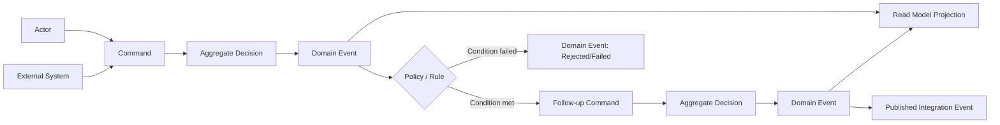
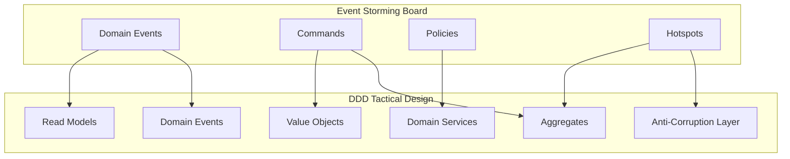
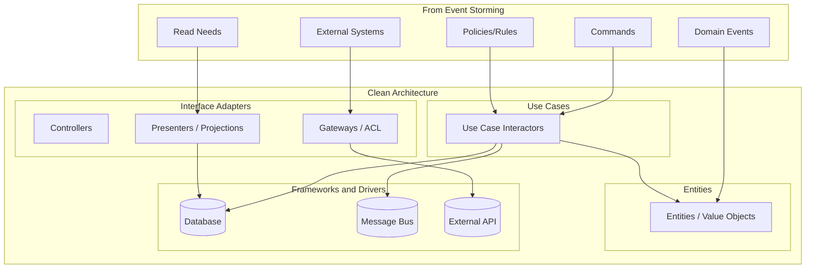
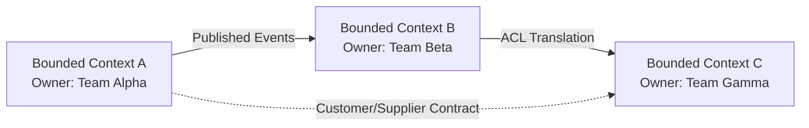

# Event Storming Playbook

A framework-agnostic playbook for discovering domain knowledge, designing software boundaries, and mapping findings to DDD and Clean Architecture.

## 1. Purpose

Event storming helps teams answer three questions quickly:

- What happens in the business domain?
- Why does it happen (rules, decisions, policies)?
- Where should software boundaries and responsibilities live?

Use this playbook for any stack (Java, .NET, Node.js, Python, Go, Rust, etc.) and any delivery style (monolith, modular monolith, microservices, serverless).

## 2. Outcomes You Should Get

By the end, you should have:

- A shared domain timeline of business events.
- Candidate aggregates, commands, policies, and read models.
- Bounded contexts and their relationships.
- A first-cut mapping from domain model to Clean Architecture layers.
- A prioritized backlog with high-risk assumptions called out.

## 3. Session Formats

Choose one based on time and maturity.

- Big Picture Event Storming (2-4 hours): Discover end-to-end flow and hotspots.
- Process-Level Event Storming (2-6 hours): Deep-dive one critical flow.
- Design-Level Storming (1-3 hours): Shape aggregates, invariants, and integration patterns.

## 4. Roles

- Facilitator: Keeps flow and enforces notation.
- Domain Experts: Explain real business behavior and exceptions.
- Engineers: Translate insights into models and architecture.
- Product/Operations: Validate value, constraints, and real-world edge cases.
- Scribe (optional): Captures decisions and open questions.

## 5. Core Notation (Color-agnostic)

If you use sticky notes, colors help. If not, just use labels.

- Domain Event: "Order Placed", "Payment Failed".
- Command/Intent: "Place Order", "Capture Payment".
- Actor: person/system triggering commands.
- Policy/Rule: "If payment is approved, reserve inventory".
- Aggregate/Entity: consistency boundary handling decisions.
- Read Model/View: query projection for users/reports.
- External System: third-party or legacy dependency.
- Hotspot: uncertainty, risk, conflict, or unclear ownership.

## 6. Step-by-Step Facilitation

### Step 1: Set Scope and Goal (10-15 min)

Define:

- Business outcome to improve.
- Start and end points.
- Timebox and decisions expected.

Prompt:

- "By the end of this session, what decision do we need to make confidently?"

### Step 2: Capture Domain Events First (30-60 min)

- Ask experts to write events as past-tense facts.
- Place events on a left-to-right timeline.
- Merge duplicates, preserve alternate flows.

Rule:

- Events represent facts that already happened, not intentions.

### Step 3: Add Commands and Actors (20-40 min)

- For each event, ask: "What triggered this?"
- Add command before the resulting event.
- Add actor/system that issued the command.

### Step 4: Add Policies and Rules (20-40 min)

- Insert policies between events and downstream commands.
- Surface conditional logic, SLAs, compliance, and retries.

### Step 5: Mark Hotspots (continuous)

Tag uncertainty and risk categories:

- Business ambiguity
- Data quality
- Integration risk
- Performance/SLA risk
- Regulatory risk

### Step 6: Discover Aggregates and Invariants (30-60 min)

- Group commands/events that require transactional consistency.
- Define invariants, for example: "Credit limit cannot be exceeded."
- Separate high-write consistency boundaries from read-heavy projections.

### Step 7: Identify Bounded Contexts (30-60 min)

- Cluster language and behavior that belong together.
- Define ownership and integration contracts.
- Decide relationship patterns (Customer-Supplier, Conformist, ACL, etc.).

### Step 8: Map to Architecture and Backlog (30-60 min)

- Convert flow into domain and application responsibilities.
- Extract integration points and technical enablers.
- Produce implementation slices by value and risk.

## 7. Diagram: Event Storming Flow

## 8. Mapping to DDD (Tactical)

Use this translation table during design.

| Event Storming Artifact | DDD Construct | What to Define |
|---|---|---|
| Domain Event | Domain Event | Name, payload, versioning, consumers |
| Command | Application Command / Use Case Input | Validation, authorization, idempotency |
| Aggregate decision area | Aggregate Root + Entities/Value Objects | Invariants, consistency boundary |
| Policy | Domain Service / Policy Handler / Process Manager | Rule logic and orchestration |
| Read Model | Projection / Query Model | Denormalized view, freshness needs |
| External System | Anti-Corruption Layer / Adapter | Translation, resilience, retries |
| Hotspot | Architectural Risk Item | Spike, test, monitoring, ownership |

## 9. Diagram: From Events to DDD Building Blocks

## 10. Mapping to Clean Architecture

Event storming clarifies which logic belongs where.

- Entities (Domain Core): invariants, domain behavior, value objects.
- Use Cases (Application): command handling, orchestration, transaction boundaries.
- Interface Adapters: controllers, presenters, gateways, ACL translators.
- Frameworks/Drivers: database, message bus, HTTP, UI, external APIs.

## 11. Diagram: Event Storming to Clean Layers

## 12. Bounded Context and Integration Choices

When splitting contexts, decide integration style per boundary:

- Synchronous request/response for immediate decisions.
- Asynchronous event-driven for decoupling and scalability.
- ACL when language/models differ significantly.
- Shared Kernel only with strong governance and low coupling risk.

## 13. Diagram: Context Map (Template)

## 14. Definition of Done for the Workshop

- Event timeline reviewed by domain experts.
- Top 5 hotspots have owners and mitigation plan.
- Aggregates and invariants documented.
- Context boundaries named and owned.
- 3-10 implementation slices prioritized.

## 15. Backlog Slice Template

Use this per slice:

- Slice name: short business outcome.
- Trigger command(s):
- Expected domain event(s):
- Aggregate(s) touched:
- Invariants to enforce:
- External dependencies:
- Read model updates:
- Acceptance criteria:
- Observability: logs/metrics/traces needed.
- Risk level and rollback strategy:

## 16. Common Pitfalls and Fixes

- Pitfall: Jumping to services/tables too early.
  - Fix: Force event-first timeline before technical design.
- Pitfall: Mixing commands and events.
  - Fix: Validate tense; events are facts in past tense.
- Pitfall: Oversized aggregates.
  - Fix: Re-check transactional invariants and write contention.
- Pitfall: Undefined ownership.
  - Fix: Add explicit bounded context owner per capability.
- Pitfall: No follow-through.
  - Fix: Leave with prioritized slices and named owners.

## 17. Lightweight Checklist

- Scope and goal are explicit.
- Events are complete enough for key journeys.
- Commands, policies, and actors are linked.
- Hotspots are visible and prioritized.
- DDD mapping is drafted.
- Clean Architecture responsibilities are assigned.
- Next iteration date is scheduled.

## 18. How to Reuse This Playbook

- Keep section 1, 6, and 17 fixed as team standard.
- Clone sections 7, 9, 11, and 13 as templates per domain.
- Adapt terminology only (not method) for each business area.
- Store resulting maps beside code and ADRs.
