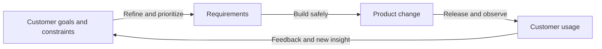
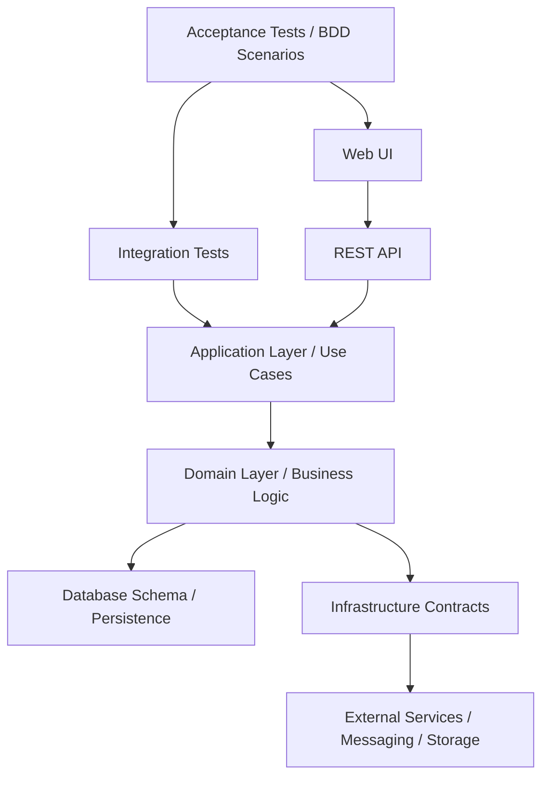
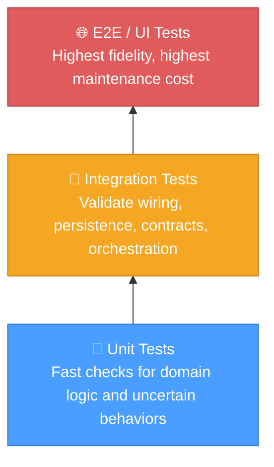

# Software Delivery Playbook
## A Start-to-Finish Guide for Complex Customer Projects

> **Purpose:** This document is a practical guide to software delivery. It provides detailed guidance on every stage of the process — from customer engagement and requirements discovery through to engineering, deployment, and ongoing operations. It is written for the author, new team members, AI assistants, and external stakeholders alike.
>
> **Foundations:** Domain-Driven Design (Eric Evans), Modern Software Engineering (Dave Farley), Martin Fowler's Catalogue, ABP Framework best practices, Clean Code (Robert C. Martin), and practical agile delivery experience.

## How to Read This Playbook

This playbook follows a delivery lifecycle from start to finish: **understand what to build → discover and specify the behavior → engineer it well → deploy it safely**.

The thread that runs through every section is **acceptance tests** — the executable, customer-agreed definitions of what the software must do. They are described early in [Acceptance Tests: The Organizing Principle](#acceptance-tests-the-organizing-principle) because they shape every decision that follows. Understanding that section changes how you read everything else.

The document is structured for two modes: **read front-to-back** for a first pass through the full process, or **navigate by section** as a reference during delivery. Each section begins with orientation — what it covers, when it matters, and what it connects to — before the detailed Q&A. Cross-links are used throughout so related decisions in different sections are explicit.

---

## Table of Contents

- [Philosophy & Mindset](#philosophy--mindset)
   - [What is the core belief driving how you work?](#what-is-the-core-belief-driving-how-you-work)
   - [What principles underpin every engagement?](#what-principles-underpin-every-engagement)
   - [Why is listening and tracing non-negotiable?](#why-is-listening-and-tracing-non-negotiable)
   - [Why is this an optimization problem?](#why-is-this-an-optimization-problem)
   - [What are the major risks from customer intent to product behavior?](#what-are-the-major-risks-from-customer-intent-to-product-behavior)
   - [Why not rely on upfront design alone?](#why-not-rely-on-upfront-design-alone)
   - [What are we selling to the customer?](#what-are-we-selling-to-the-customer)
    - [What does a satisfied customer look like?](#what-does-a-satisfied-customer-look-like)
- [Acceptance Tests: The Organizing Principle](#acceptance-tests-the-organizing-principle)
    - [What are acceptance tests?](#what-are-acceptance-tests)
    - [Why acceptance tests sit at the centre of everything](#why-acceptance-tests-sit-at-the-centre-of-everything)
    - [How each discipline connects to acceptance tests](#how-each-discipline-connects-to-acceptance-tests)
- [Discovery & Requirements](#discovery--requirements)
    - [Business Analysis & Specification](#business-analysis--specification)
        - [How do we ensure we speak the same language?](#how-do-we-ensure-we-speak-the-same-language)
        - [What are some tools for extracting requirements?](#what-are-some-tools-for-extracting-requirements)
        - [What to do if we have no time and the customer wants a first draft](#what-to-do-if-we-have-no-time-and-the-customer-wants-a-first-draft)
        - [What is Event Storming and when is it used?](#what-is-event-storming-and-when-is-it-used)
        - [How does frontend prototyping help discovery and requirements?](#how-does-frontend-prototyping-help-discovery-and-requirements)
        - [How are BDD scenarios and concrete test cases written?](#how-are-bdd-scenarios-and-concrete-test-cases-written)
        - [What is the difference between acceptance criteria and acceptance tests?](#what-is-the-difference-between-acceptance-criteria-and-acceptance-tests)
        - [Why this approach: advantages and limitations of alternatives](#why-this-approach-advantages-and-limitations-of-alternatives)
        - [How does actor framing split features during BA?](#how-does-actor-framing-split-features-during-ba)
        - [Why must list and read behaviors be captured during BA?](#why-must-list-and-read-behaviors-be-captured-during-ba)
        - [How do task dependencies and technical tasks emerge during implementation?](#how-do-task-dependencies-and-technical-tasks-emerge-during-implementation)
        - [What is the relationship between requirements and the domain model?](#what-is-the-relationship-between-requirements-and-the-domain-model)
    - [Strategic Domain Modelling](#strategic-domain-modelling)
        - [What is Domain-Driven Design (DDD)?](#what-is-domain-driven-design-ddd)
        - [What is a Bounded Context?](#what-is-a-bounded-context)
        - [What is a Context Map?](#what-is-a-context-map)
- [Development](#development)
    - [Quality Engineering](#quality-engineering)
        - [What is the testing philosophy?](#what-is-the-testing-philosophy)
        - [What are the layers of the test pyramid?](#what-are-the-layers-of-the-test-pyramid)
        - [How do you choose the right test mix?](#how-do-you-choose-the-right-test-mix)
        - [What makes a good unit test?](#what-makes-a-good-unit-test)
        - [What is Test-Driven Development (TDD)?](#what-is-test-driven-development-tdd)
        - [How do you test domain logic and the application layer?](#how-do-you-test-domain-logic-and-the-application-layer)
        - [Why should you not use "mocks"?](#why-should-you-not-use-mocks)
        - [How is quality engineered in day-to-day delivery?](#how-is-quality-engineered-in-day-to-day-delivery)
        - [What are the core principles behind high quality output?](#what-are-the-core-principles-behind-high-quality-output)
        - [What additional quality controls are still valuable?](#what-additional-quality-controls-are-still-valuable)
        - [Why should admin functionality be built first?](#why-should-admin-functionality-be-built-first)
        - [Why is direct database access for maintenance dangerous?](#why-is-direct-database-access-for-maintenance-dangerous)
    - [Architecture Design](#architecture-design)
        - [Tactical DDD Building Blocks](#tactical-ddd-building-blocks)
        - [What is the Anemic Domain Model anti-pattern?](#what-is-the-anemic-domain-model-anti-pattern)
        - [When should you not use DDD?](#when-should-you-not-use-ddd)
        - [How does DDD relate to microservices?](#how-does-ddd-relate-to-microservices)
        - [What architectural approach do you follow?](#what-architectural-approach-do-you-follow)
        - [Where does the classic layered diagram come from?](#where-does-the-classic-layered-diagram-come-from)
        - [What is the criticism of the stacked layered diagram?](#what-is-the-criticism-of-the-stacked-layered-diagram)
        - [What does the preferred dependency model look like?](#what-does-the-preferred-dependency-model-look-like)
        - [What is the responsibility of each part?](#what-is-the-responsibility-of-each-part)
        - [What is the Application Layer responsible for?](#what-is-the-application-layer-responsible-for)
        - [What are Data Transfer Objects (DTOs)?](#what-are-data-transfer-objects-dtos)
        - [What is CQRS?](#what-is-cqrs)
        - [What is Event Sourcing?](#what-is-event-sourcing)
        - [How do you decide between a monolith, modular monolith, and microservices?](#how-do-you-decide-between-a-monolith-modular-monolith-and-microservices)
        - [What architectural decisions must be documented?](#what-architectural-decisions-must-be-documented)
        - [How do you handle cross-cutting concerns?](#how-do-you-handle-cross-cutting-concerns)
        - [How should external service integrations be designed?](#how-should-external-service-integrations-be-designed)
        - [How do you keep external data in sync reliably?](#how-do-you-keep-external-data-in-sync-reliably)
        - [Why can't a database transaction and an external API call be made atomic?](#why-cant-a-database-transaction-and-an-external-api-call-be-made-atomic)
        - [How is multi-tenancy data isolation enforced?](#how-is-multi-tenancy-data-isolation-enforced)
        - [How should roles, permissions, and admin access be designed?](#how-should-roles-permissions-and-admin-access-be-designed)
        - [How do permissions and features map to acceptance criteria and implementation?](#how-do-permissions-and-features-map-to-acceptance-criteria-and-implementation)
        - [How does Event Storming output map to architecture and persistence?](#how-does-event-storming-output-map-to-architecture-and-persistence)
    - [Engineering Practices](#engineering-practices)
        - [Development Practices](#development-practices)
            - [What does "clean code" mean in practice?](#what-does-clean-code-mean-in-practice)
            - [What SOLID principles guide your design?](#what-solid-principles-guide-your-design)
            - [What is the preferred way to handle dependencies?](#what-is-the-preferred-way-to-handle-dependencies)
            - [How do you approach naming?](#how-do-you-approach-naming)
            - [How do you approach code reviews?](#how-do-you-approach-code-reviews)
            - [What is your approach to technical debt?](#what-is-your-approach-to-technical-debt)
            - [What is refactoring and when should it happen?](#what-is-refactoring-and-when-should-it-happen)
        - [Git Workflow](#git-workflow)
            - [What branching strategy do you use?](#what-branching-strategy-do-you-use)
            - [How do you write good commit messages?](#how-do-you-write-good-commit-messages)
            - [What is your pull request and code review process?](#what-is-your-pull-request-and-code-review-process)
        - [Vertical Slices](#vertical-slices)
            - [What is a vertical slice?](#what-is-a-vertical-slice)
            - [How do you slice a feature for delivery?](#how-do-you-slice-a-feature-for-delivery)
    - [Implementation Layers](#implementation-layers)
        - [Frontend](#frontend)
            - [How is the frontend structured?](#how-is-the-frontend-structured)
            - [What are dumb and smart components?](#what-are-dumb-and-smart-components)
            - [How does the frontend communicate with the backend?](#how-does-the-frontend-communicate-with-the-backend)
            - [What is the Backend for Frontend (BFF) pattern?](#what-is-the-backend-for-frontend-bff-pattern)
            - [How do you keep frontend and backend API contracts in sync?](#how-do-you-keep-frontend-and-backend-api-contracts-in-sync)
            - [How do WebSockets keep the frontend up-to-date?](#how-do-websockets-keep-the-frontend-up-to-date)
            - [How do you make the frontend feel fast?](#how-do-you-make-the-frontend-feel-fast)
        - [Backend](#backend)
            - [How is the backend structured?](#how-is-the-backend-structured)
            - [How are API endpoints defined and versioned?](#how-are-api-endpoints-defined-and-versioned)
            - [How should incoming webhooks be handled?](#how-should-incoming-webhooks-be-handled)
            - [How should background jobs be designed?](#how-should-background-jobs-be-designed)
        - [Database](#database)
            - [How is database access managed?](#how-is-database-access-managed)
            - [How do list and read behaviors shape database architecture?](#how-do-list-and-read-behaviors-shape-database-architecture)
            - [How are migrations handled?](#how-are-migrations-handled)
- [Infrastructure Design](#infrastructure-design)
    - [What is the default infrastructure strategy?](#what-is-the-default-infrastructure-strategy)
    - [When should managed cloud services be introduced?](#when-should-managed-cloud-services-be-introduced)
    - [How do non-functional requirements drive infrastructure evolution?](#how-do-non-functional-requirements-drive-infrastructure-evolution)
    - [What infrastructure anti-patterns should be avoided?](#what-infrastructure-anti-patterns-should-be-avoided)
- [Release & Deployment](#release--deployment)
    - [How should deployment automation evolve with infrastructure maturity?](#how-should-deployment-automation-evolve-with-infrastructure-maturity)
    - [What are CI and CD and where do they come from?](#what-are-ci-and-cd-and-where-do-they-come-from)
    - [What is Continuous Delivery in practice?](#what-is-continuous-delivery-in-practice)
    - [What does a deployment pipeline look like?](#what-does-a-deployment-pipeline-look-like)
    - [What environments are needed?](#what-environments-are-needed)
    - [How do you manage configuration across environments?](#how-do-you-manage-configuration-across-environments)
    - [Why are long-lived branches harmful?](#why-are-long-lived-branches-harmful)
    - [What are feature flags and why are they the alternative to branching?](#what-are-feature-flags-and-why-are-they-the-alternative-to-branching)
    - [How should database changes be handled during deployment?](#how-should-database-changes-be-handled-during-deployment)
    - [What are the deployment flows and how do they differ?](#what-are-the-deployment-flows-and-how-do-they-differ)
    - [When should git revert be used and when must we go forward?](#when-should-git-revert-be-used-and-when-must-we-go-forward)
- [Reference Glossary](#reference-glossary)

---

## Philosophy & Mindset

This section establishes the values and reasoning that underpin every other decision in this playbook. It is not aspirational decoration — the principles here have direct consequences for how requirements are captured, how code is written, and how delivery is structured. Read it first; refer back to it when any later section needs a "why" behind a practice.

### What is the core belief driving how you work?

Customer satisfaction is the core objective. We are not only trying to deliver what customers ask for; we are trying to exceed expectations by solving problems they did not yet see clearly.

Customers usually know what they want to achieve and roughly how they operate, but they often struggle to assemble the full solution safely and coherently. Our job is to turn their intent into reliable software outcomes.

Trust is the compounding asset behind all long-term delivery. We build trust through consistent customer satisfaction: clear communication, predictable execution, visible quality, and honest handling of risk.

> *"The only way to go fast is to go well."* — Robert C. Martin
>
> *"I like people who can get stuff done."* — Barack Obama



### What principles underpin every engagement?

- **One loop, end to end.** The process is a continuous loop from customer to product and back again.
- **Trust through outcomes.** Trust is earned by repeatedly delivering valuable, reliable results.
- **Iteration over speculation.** The most reliable way to refine requirements is to implement, validate, and iterate.
- **Safety enables speed.** Fast iteration is only useful when change is safe and reversible.
- **Design from evidence.** Good design is extracted from proven implementation and behavior, not guessed in isolation.
- **Future-proofing through process.** Every practice in this guide exists to prevent degradation over time while keeping delivery fast.

### Why is listening and tracing non-negotiable?

Customer satisfaction is not a vague goal — it is a precision discipline. If a customer says something, it must be:

1. **Captured** — recorded clearly at the point it is said.
2. **Traced** — linked to a requirement, task, or decision so nothing is lost.
3. **Acted on** — actually implemented or consciously deferred with justification.
4. **Reported back** — confirmed to the customer so they know it was heard and handled.

Failing any one of these steps breaks trust. Customers do not always remember everything they said, but they always notice when something they cared about was quietly dropped.

Written requirements are not bureaucracy — they are a safety mechanism. They exist to protect the customer's intent from being diluted, forgotten, or misunderstood across time and people.

> No risks can be taken with customer satisfaction or trust. These are the foundation everything else rests on.

### Why is this an optimization problem?

This guide optimizes for two competing forces:
- **Risk** (wrong requirements, missing requirements, latent bugs, migration mistakes, security gaps)
- **Time** (how quickly we can move from idea to validated outcome)

At a high level:

$$
Value = max(CustomerOutcome) - (Risk + CycleTime)
$$

Plain text: Value = maximize(Customer Outcome) while minimizing(Risk + Cycle Time).

In practice, this means shortening feedback loops without sacrificing safety.

### What are the major risks from customer intent to product behavior?

- **Wrong requirements.** We built the wrong behavior, even if it is well engineered.
- **Missing requirements.** Important scenarios were never surfaced during discovery.
- **Unsafe change.** Inexperienced teams can introduce hidden regressions, including issues that surface months later.
- **Data and migration failures.** Incorrect data movement can create delayed but severe operational failures.

The response is not bigger upfront design documents; it is safer, smaller, faster iteration with stronger validation.

### Why not rely on upfront design alone?

High-quality design still requires understanding real constraints in code, deployment, and operations. In practice, teams often have to mentally simulate implementation anyway, which costs nearly as much as building a thin, validated slice.

Many times, before a customer says "yes" confidently, we already need a working implementation to prove the behavior. That implementation then becomes the most accurate source of design truth.

### What are we selling to the customer?

We are selling expertise first. The product is the outcome of that expertise.

1. **Problem and requirements clarity.** We turn ambiguous intent into clear, testable requirements through iterative discovery and business analysis.
2. **Delivery leadership and project control.** We manage scope, risk, priorities, and progress through a disciplined delivery process.
3. **People-centered quality validation.** We run meaningful as-user QA/UAT gates so real workflows are validated before release.
4. **Engineering system for safe speed.** We apply robust development practices to produce reliable, readable, extendable systems that can evolve quickly without degradation.
5. **Operational excellence.** We handle infrastructure setup/management, ongoing support/maintenance, security checks, and performance improvements as part of continuous delivery.

Result: lower stress, lower long-term cost, and higher confidence in every iteration.

### What does a satisfied customer look like?

A satisfied customer is not simply one whose feature list was ticked off. They are a customer who sees that we thought through every decision, that the product feels polished, and that we can be trusted to handle the next engagement with the same care.

**Quality that goes beyond the brief.** We hold ourselves to a standard where every deliverable arrives as if it had already been through several rounds of UAT internally. Functional requirements are met in full; non-functional requirements — performance, security, accessibility, reliability — are treated as first-class concerns, not afterthoughts. Edge cases, error paths, and real-world usage patterns are considered before the customer has a chance to catch them in testing. The goal is to put a polished product on the table, not a proof-of-concept dressed up for a demo.

**Best practices grounded in evidence.** We make specialist decisions — architecture choices, technology selections, design patterns, naming conventions — based on established best practice and our own documented reasoning. For backend systems, this means SOLID principles, Clean Architecture, DRY, and other proven patterns for building maintainable systems. For UI and design, our choices are grounded in research and best practices from established UI frameworks. We do not ask customers to weigh in on questions that are our professional responsibility. What we do instead is log the reasoning behind every significant decision so that when a customer asks "why did you do it this way?", we have a clear, honest answer ready. Every "Why?" should have a written answer.

**Customer partnership over process overhead.** We follow the Agile Manifesto: responding to feedback and keeping the customer in the loop is more important than drowning in documentation. We avoid unnecessary paperwork, but we maintain clear reasoning about the decisions we make. Staying customer-centric means faster feedback loops and fewer surprises, not abandoning quality thinking.

**Trust built through explainability.** Customers cannot fully evaluate technical decisions directly, but they can evaluate whether we have thought them through. When we can walk a customer through our reasoning — calmly, without defensiveness, with evidence and references to established practice — they begin to trust our judgement on the decisions they cannot see. That trust is what makes a satisfied customer into a long-term customer. They are not just happy with the outcome; they believe in the expertise behind it.

> The measure of a successful engagement is not "did we deliver?" — it is "does the customer believe we are the right people to deliver the next thing too?"

---

## Acceptance Tests: The Organizing Principle

Before we discuss requirements, architecture, databases, or infrastructure, there is one idea that unifies every section of this playbook. It belongs here, before any of the detail, because it changes how you read everything that follows.

### What are acceptance tests?

Acceptance tests are executable checks of functional requirements. They prove that the application and domain core behaves correctly when driven through its application boundary.

They are derived from agreed business scenarios, usually written in Given/When/Then form during discovery and business analysis. The scenario states what must be true. The acceptance test is the executable verification that proves it is true.

In practice, acceptance tests sit above unit tests and below human-facing channels like the web UI, CLI, or desktop app. They do not replace those channels; they verify the same core behavior more directly and more repeatably.

This is why acceptance tests are the bare minimum. User stories, process notes, wireframes, architecture diagrams, ADRs, spreadsheets, and meeting write-ups can all be useful, but none of them are enough on their own. They can describe intent, provide context, or explain reasoning, but they do not give the team an executable definition of done. Without acceptance tests, the team is still interpreting, guessing, and filling in gaps.

Other document types are still valuable. They help people think, communicate, and record decisions. But the minimum artefact that turns requirements into something buildable and verifiable is the acceptance test. If that is missing, the rest of the documentation is supporting material around an empty centre.

This section explains **what** acceptance tests are and why they matter. The process for extracting them from customers is covered in [What are some tools for extracting requirements?](#what-are-some-tools-for-extracting-requirements), [What is Event Storming and when is it used?](#what-is-event-storming-and-when-is-it-used), [How does frontend prototyping help discovery and requirements?](#how-does-frontend-prototyping-help-discovery-and-requirements), and [How are BDD scenarios and concrete test cases written?](#how-are-bdd-scenarios-and-concrete-test-cases-written). The downstream use of that input by developers and architects is covered in [How each discipline connects to acceptance tests](#how-each-discipline-connects-to-acceptance-tests), [How do permissions and features map to acceptance criteria and implementation?](#how-do-permissions-and-features-map-to-acceptance-criteria-and-implementation), and [How does Event Storming output map to architecture and persistence?](#how-does-event-storming-output-map-to-architecture-and-persistence).

Example business scenario:

```gherkin
Scenario: Customer cancels an order before dispatch
    Given an order has been paid for
    And the order has not yet been dispatched
    When the customer cancels the order
    Then the order status becomes "Cancelled"
    And the payment is marked for refund
```

Example acceptance test intent:

```text
Call the cancel-order use case through the application boundary,
then assert that:
- the order state is Cancelled
- a refund has been requested
- the cancellation is rejected if dispatch has already happened
```

The same behavior might later be exercised through:
- a web UI button
- a CLI command
- a desktop app action
- an API request

Those are all interfaces into the same core behavior. The acceptance test is simply the most direct, precise, and repeatable one.

### Why acceptance tests sit at the centre of everything

Two classes of requirement drive every engineering decision in this process:

- **Functional requirements** — captured as acceptance tests (BDD scenarios agreed with the customer and domain experts). These describe the precise behaviors the software must exhibit: what a user can do, what the system must enforce, what outcomes must result.
- **Non-functional requirements** — constraints on *how well* the software must do it: performance, scalability, availability, security, accessibility, data retention. These are captured explicitly during requirements work and inform design at every layer, but they are not written as BDD scenarios.

Together, these two inputs are the contract. Every significant downstream decision — how the UI is structured, how the backend is designed, how the database is modelled, how infrastructure is sized — should be traceable back to one or both.

Think of the contract as building a full picture of one system using multiple cameras. Each acceptance test captures the behavior from a specific angle. One camera alone gives a partial view; many cameras give a reliable picture of the whole. Non-functional requirements add the operating constraints for that same picture: how fast, how secure, how available, how scalable.

Acceptance tests matter so much because they describe human interaction with the system in a form that engineering can build from. Those scenarios shape the UI. The UI shapes the REST API. The REST API is built on the application layer, which orchestrates the domain layer. Acceptance tests also drive integration tests that hit the application layer directly, proving the core behavior without going through the UI. From there, the domain defines the persistence, infrastructure, and external service contracts needed to make the behavior real.

**Figure: How Acceptance Tests affect the software architecture**



The acceptance tests emerge from **Event Storming** during requirements work. Non-functional requirements are surfaced alongside them. Once both are agreed, they become the shared reference that every team member works from. Nothing downstream should be invented independently of them.

In implementation terms, there is one core (application and domain layers) and more than one way to exercise it. The UI is one route. Integration tests are another. Acceptance tests are the source that shapes both: they describe the required human behavior, and they let us verify that behavior as close to the application boundary as possible.

> Every section that follows — Requirements, Architecture, Frontend, Backend, Database, Infrastructure, Deployment — should be read through the lens of: *how does this serve the agreed behavior contract and constraints, and the shared core they define?*

### How each discipline connects to acceptance tests

**UI design** reads acceptance tests to understand the complete set of user states, workflows, actions, and outcomes that must be reachable in the interface. A designer should not have to guess what happens when a user does something unexpected — the acceptance tests define every meaningful scenario. UI patterns and component choices are then grounded in best practices from established frameworks, but those choices serve the scenarios, not the other way around.

**Backend architecture** reads acceptance tests to identify commands, queries, domain events, aggregates, and application use cases. The tests reveal what behaviors must be enforced in the domain layer, what data must flow where, and what the application layer must orchestrate. SOLID principles, Clean Architecture, and DDD patterns are the tools used to implement those behaviors reliably — they are the means, not the source of requirements.

**Database schema** is shaped by what acceptance tests require to be queryable, writable, and consistent. Read-heavy scenarios drive read model design. Write scenarios drive aggregate persistence. Non-functional requirements (performance, scale, concurrency) drive indexing, partitioning, and replication decisions. The database is not designed in isolation; it is designed to satisfy specific tested behaviors and declared constraints.

**Infrastructure** is sized and designed from the non-functional requirements captured during requirements work: expected throughput, acceptable latency, availability targets, data retention constraints. A non-functional requirement that says "a user should receive a confirmation within two seconds" is an infrastructure design constraint as much as it is an engineering one.

**Release pipeline** is structured around the acceptance test suite as the primary gate. A build passes when all acceptance tests pass — not when unit tests pass, not when linting passes. The pipeline enforces that the contract agreed with the customer remains satisfied on every change.

---

## Discovery & Requirements

### Business Analysis & Specification

This section defines how understanding becomes executable detail. It translates customer language into structured requirements, acceptance criteria, and decision records that engineering can build and validate safely.

### How do we ensure we speak the same language?

Start BA by establishing a **Ubiquitous Language**: a shared, precise vocabulary built collaboratively between developers and domain experts. This becomes the working glossary for the engagement.

It must be used consistently:
- In code: class names, method names, variables
- In conversations: workshops, meetings, emails, chat
- In documentation: requirements, diagrams, ADRs, notes
- In tests: scenarios, acceptance tests, assertions

When the language in the code diverges from the language the business uses, the model drifts from reality. The cost of translation becomes a constant source of bugs, ambiguity, and rework.

In practical terms, this means keeping a shared glossary as part of BA output and refining it continuously as requirements work progresses. If one stakeholder says "customer", another says "account", and a third means "billing entity", those differences must be resolved explicitly before requirements are written.

BA establishes the domain glossary early and keeps refining it into a precise working language that developers, architects, and stakeholders all use when discussing behavior.

> A requirement written in language the customer would never use is already a translation away from being correct.

### What are some tools for extracting requirements?

Use three primary tools by default. Keep the sequence strict unless there is a clear reason to deviate.

| Tool | Primary purpose | Pros | Trade-off |
|---|---|---|---|
| Event Storming | Discover domain flow, rules, actors, and boundaries | Rapid shared model; ambiguity surfaces early; strong DDD input | Requires active facilitation and domain expert time |
| Frontend prototyping | Validate user workflows and UX states | Fast stakeholder feedback; exposes missing paths and wording gaps | Can over-focus on UI if not tied back to domain rules |
| BDD scenario workshops | Convert agreed behavior into executable Given/When/Then specs | Clear path to acceptance tests; reduces translation loss | Needs discipline to stay business-readable and concrete |

Default sequence:
1. Event Storming first.
2. Frontend prototype second.
3. BDD scenarios and concrete examples third.
4. Acceptance test automation fourth.

Quality gate before coding: no implementation starts until steps 1-3 are reviewed and agreed by domain experts.

### What to do if we have no time and the customer wants a first draft

Use an **AI-assisted Draft 1** flow. This is a pre-sales operating mode for cases where customer time is limited but a credible end-to-end draft is needed before deeper workshops.

What Draft 1 should include:
- Candidate acceptance tests for core workflows
- A frontend prototype for the highest-value user journeys
- A backend/domain outline (main use cases, aggregates, boundaries)
- A first-pass infrastructure and deployment shape
- Explicit assumptions, open questions, and risk flags

Default Draft 1 sequence:
1. Generate initial workflow hypotheses from available material (briefs, emails, existing systems, similar projects).
2. Prototype key frontend flows quickly to make behavior concrete.
3. Derive acceptance tests and concrete examples from those flows.
4. Sketch backend and infrastructure to satisfy the drafted tests.
5. Present as **Draft 1 for validation**, not final requirements.

Why AI matters here:
- Without AI, this level of pre-sales synthesis is expensive and often too shallow.
- With AI, teams can explore more scenarios, edge cases, and architecture options quickly.
- This enables better first conversations with customers and higher-quality refinement once collaboration starts.

Guardrails:
- Treat every Draft 1 item as a hypothesis until customer/domain-expert review.
- Label confidence level per item (high/medium/low).
- Do not start full implementation from Draft 1 alone.
- Convert Draft 1 into agreed scenarios through Event Storming/workshops as soon as customer time is available.

### What is Event Storming and when is it used?

Event Storming (Alberto Brandolini) is a collaborative workshop technique used to rapidly model complex business domains. It is **the primary bridge between customer needs and BDD scenarios**. The output directly shapes which scenarios to write and which domain architecture to build.

**When to use it:** Early in requirements extraction on any domain with process complexity or multiple stakeholders. It is essential when domain experts disagree — those disagreements surface the hardest design problems early.

**The sticky note vocabulary (classic Big Picture):**

| Colour | Element | Meaning |
|---|---|---|
| Orange | **Domain Event** | Something that happened in the domain ("Order Placed", "Payment Received", "Inventory Reserved") |
| Blue | **Command** | The action that caused the event ("Place Order", "Process Payment", "Reserve Inventory") |
| Yellow | **Actor** | The person or system issuing the command ("Customer", "Payment Gateway", "Warehouse System") |
| Yellow (large) | **Aggregate** | The domain object that processes the command and emits the event |
| Lilac | **Policy / Reaction** | A business rule that triggers automatically ("When PaymentFailed, then SendNotification") |
| Pink | **Read Model / View** | Information an actor needs to make a decision |
| Red | **Hot Spot** | A dispute, ambiguity, or unresolved question — do not gloss over these |

**The flow from workshop to specification and code:**

```
Event Storming session (1-2 days)
  └─ Domain Events, Commands, Actors, Policies mapped on timeline
       └─ Natural clusters identified → potential Bounded Contexts
            ├─ Each cluster → BDD scenarios capturing the workflow
            ├─ Scenarios written in plain Given/When/Then
            └─ Scenarios become acceptance tests in code
                 ├─ Aggregates → domain classes owning business rules
                 ├─ Commands → application layer handlers (one per scenario)
                 ├─ Events → raised inside aggregates, handled by policies
                 └─ Read Models → query handlers / API response shapes
```

**Practical tips for effective Event Storming:**
- Start with events only — resist naming commands or aggregates until the timeline feels stable
- Hot spots (red stickies) are gold. They often become the most important architectural decisions; resolve them before starting code
- Overlapping or disputed language between clusters is the strongest signal of a Bounded Context boundary
- A policy ("when X, then Y") that crosses clusters indicates an integration point — decide deliberately whether it uses events, services, or direct calls
- The session does not need to produce a perfect model; it needs to surface enough shared understanding to write BDD scenarios
- Record the timeline visually (photos or digital capture). This is the source of truth for what scenarios to write.

**Output artifacts from Event Storming:**
1. Visual timeline of events (photo of the workshop board)
2. List of domain events in order
3. Identified aggregates and their responsibilities
4. Hot spots flagged for architectural decisions
5. Rough Bounded Context boundaries
6. Policy reactions and their rules

These artifacts immediately inform which BDD scenarios to write and how to slice them.

### How does frontend prototyping help discovery and requirements?

Frontend prototyping is a requirements tool, not just a design activity. It makes user-facing behavior visible early so stakeholders can react to something concrete.

What it helps uncover:
- Missing workflow steps and transitions (including cancellation and recovery paths)
- Ambiguous wording in UI labels, statuses, and decision points
- Role differences (what each actor can see and do)
- Hidden non-functional expectations (perceived speed, feedback timing, accessibility needs)

How to use it safely:
1. Prototype only the highest-risk workflows first.
2. Walk prototypes with real users or domain experts and capture corrections immediately.
3. Translate each validated workflow into BDD scenarios and concrete test cases.
4. Confirm business rules in domain language before backend implementation.

Pros:
- Fast feedback and alignment
- Better communication with non-technical stakeholders
- Early detection of requirement gaps

Cons:
- Can create false confidence if backend/domain constraints are ignored
- Can attract premature visual polish instead of behavior clarification
- May hide data and integration complexity unless paired with Event Storming

Used together, Event Storming and frontend prototyping are complementary: Event Storming structures domain behavior, and prototyping validates how that behavior is experienced by users.

### How are BDD scenarios and concrete test cases written?

#### Level 1: Abstract Scenario (Pattern)

Using **Gherkin / Given-When-Then** format:

```
Scenario: [What the scenario demonstrates]
  Given [a general state or context],
  When [an action occurs],
  Then [the expected outcome].
```

**Key principles:**
- Write in business language, not technical implementation details
- Focus on the *pattern* of behavior, not specific data
- One scenario = one discrete behavior type
- Should be anchored in domain events and workflows identified during Event Storming

**Example (abstract):**
```
Scenario: Customer places order with insufficient inventory
  Given some items are in stock
  And customer orders more than available
  When the customer submits the order
  Then available items are reserved
  And remaining items are backordered
```

#### Level 2: Concrete Test Cases (With Specific Data)

Take the abstract scenario and **expand it with specific, agreed-upon values.**

**Critical:** This is co-authored work. The developers should not guess at the numbers. Ask domain experts:
- What are valid input ranges?
- What are the exact error messages?
- What edge cases exist?
- What time windows or thresholds apply?
- What happens at boundaries (zero, negative, very large)?

**Example (concrete, co-authored with customer):**
```
Scenario: Backorder 3 items when 5 are in stock
  Given inventory = 5 widgets
  And customer orders 8 widgets
  When the customer submits the order
  Then 5 widgets transition to "Reserved"
  And 3 widgets transition to "Backordered"
  And order status = "Partial - Ready to Ship"
  And customer receives email subject: "Order #12345: 5 of 8 items ready"
  And email body contains: "Expected delivery for backorder: [supplier_date]"

Scenario: All items backordered when zero in stock
  Given inventory = 0 widgets
  And customer orders 5 widgets
  When the customer submits the order
  Then order status = "All Backordered"
  And customer receives email subject: "Order #12345: All items backordered"
  And no inventory is reserved

Scenario: Backorder expiration at 60 days
  Given customer placed backorder on 2026-01-01
  And today's date is 2026-03-01 (60 days later)
  When the system runs backorder review
  Then customer receives email: "Your backorder for Order #12345 expires in 7 days"
  And if customer does not confirm by 2026-03-08
  Then backorder is cancelled
```

**Characteristics of good concrete test cases:**
- **Testable**: Specific enough that developers cannot misinterpret
- **Complete**: All inputs, states, and expected outputs are explicit
- **Domain-aligned**: Numbers and messages are real business constraints, not developer guesses
- **Boundary-covered**: Include zero, edge values, time transitions
- **Customer-reviewed**: Domain experts confirm these are the correct numbers and behaviors

#### Level 3: Acceptance Test Code (Automation)

Developers implement the concrete test cases as executable code:

```gherkin
Scenario: Backorder 3 items when 5 are in stock
  Given inventory has exactly 5 widgets
  And customer adds 8 widgets to cart
  When customer submits order
  Then order shows status "Partial - Ready to Ship"
  And 5 items are in "Reserved" state
  And 3 items are in "Backordered" state
  And customer email recipient = customer@example.com
  And email subject = "Order #12345: 5 of 8 items ready"
  And email contains text "Expected delivery for backorder"
```

The test code is written in a language stakeholders can still read (Gherkin in SpecFlow/Cucumber). **Before the developer marks test code done, stakeholders should review it and confirm:** "Yes, this test is checking exactly what we agreed in the concrete test case."

**Why this matters:**
- If the test code drifts from the concrete case, stakeholders won't catch it during review
- Test code that is too technical or hidden hides bugs and assumptions
- Stakeholders must be able to verify the test matches what was agreed

**Anti-pattern: Technical test code**

DO NOT write:
```
Scenario: Calculate shipping via ShippingService
  Given ShippingService is instantiated
  And cart.Items contains 2 OrderItem objects
  When service.CalculateShipping(cart) is called
  Then result.TotalCharge is not null
```

This is implementation detail, not behavior. It hides what is actually being tested from stakeholders. They cannot verify this matches what they agreed.

**The three-level summary:**

| Level | Format | Authors | Purpose |
|---|---|---|---|
| 1. Scenario Pattern | Gherkin (abstract) | BA + domain experts | Identify behavior class |
| 2. Concrete Cases | Gherkin (specific data) | Domain experts + developers together | Define exact values, edge cases, messages |
| 3. Test Code | Gherkin (automation) | Developers | Implement verification; stakeholders review |

All three are Gherkin/Given-When-Then so the language remains consistent. The difference is abstraction level and who contributes what.

### What is the difference between acceptance criteria and acceptance tests?

They are related but exist at different levels.

Acceptance criteria incrementally define the system behavior we expect. As scenarios accumulate, ambiguity drops and implementation becomes safer.

For the full definition of acceptance tests and examples, see [What are acceptance tests?](#what-are-acceptance-tests).

At a high level:

| | BDD Scenario / Acceptance Criteria | Acceptance Test |
|---|---|---|
| **Purpose** | Define what behavior is required | Verify behavior has been implemented |
| **Language** | Business language (Given/When/Then) | Executable code or automation steps |
| **Written when** | Before development begins | During development, before code is complete |
| **Primary audience** | Business stakeholder + team | Developer + automation + CI |

**The important distinction:**

A single BDD scenario can be verified by:
- An automated test (runs on every commit)
- A manual check by QA (visual layout, accessibility feel)
- A demo to the customer (business rule validation)

The scenario does not prescribe *how* verification happens — that is an engineering decision based on risk and value.

**Not every scenario needs automation.** Some scenarios are better verified by a human observer. Automate high-value regression targets; verify edge cases and visual/UX concerns manually.

**The risk of conflating them:**

- Writing tests in code first without agreeing scenarios with stakeholders: breaks shared ownership of spec
- Treating test code as the acceptance criteria: criteria become invisible to business stakeholders
- Marking done because tests pass, when tests were written to confirm already-built behavior (backwards): this is post-facto validation, not specification

**Correct flow:**

```
Domain experts + BA agree on BDD scenarios (Given/When/Then, plain language)
  └─ Developer writes automated acceptance tests against scenarios (during development)
       └─ Tests pass → scenarios satisfied → behavior proven → ready to demo
```

The scenarios are the source of truth. The test is the verification mechanism.

Where practical, express tests in Gherkin so the executable test language matches business-facing scenarios exactly.

For the full three-level detail — abstract scenarios, concrete test cases, and test code — see [How are BDD scenarios and concrete test cases written?](#how-are-bdd-scenarios-and-concrete-test-cases-written).

### Why this approach: advantages and limitations of alternatives

Why center on **Event Storming → BDD Scenarios → Acceptance Tests** instead of traditional requirements?

#### Advantages of This Approach

**1. Executable Specification**
- BDD scenarios are not just documentation; they become automated tests that run on every code change
- Scenarios stay current (they must pass in CI) — no stale documents
- Contradictions between scenarios and code are caught immediately

**2. Domain Clarity**
- Event Storming surfaces disagreements *before* code is written, when they are cheapest to resolve
- Shared domain language emerges naturally from the workshop
- Hot spots are explicitly flagged and given architectural attention

**3. Direct Path to Architecture**
- Domain events discovered in Event Storming map directly to aggregates, domain services, and bounded contexts
- No translation loss: what stakeholders say about the domain becomes what the code expresses
- Architecture decisions are grounded in behavior, not abstract principles

**4. Fast Feedback Loop**
- Scenarios can be written and tested within hours of Event Storming
- Developers start with working tests, not a vague spec
- Implementation reveals missing requirements early (during test writing), not late (during UAT)

**5. No Hidden Dependencies**
- Repeated patterns in scenarios (same commands, events, rules) expose shared architectural components
- Technical tasks emerge naturally as scenarios are implemented
- Estimation is based on scenario complexity, not abstract story sizes

#### Limitations of Alternatives

**Traditional Requirements Documents**
- ❌ Static: Become obsolete as the domain evolves or is refined during implementation
- ❌ Ambiguous: English prose is full of interpretation gaps; two readers may understand different things
- ❌ Untestable: A requirements doc cannot fail; a misunderstanding is only caught during UAT
- ❌ Lengthy: Writing comprehensive specs takes weeks; by then, stakeholders have changed their minds
- ❌ Translation loss: Business language → developer implementation → customer verification requires multiple interpretation steps

**User Story format (As a / I want / So that)**
- ❌ Hides shared enablers: Multiple stories sharing dependencies don't show the real effort required
- ❌ Sizing unit problem: Stories are meant for communication but get used for effort estimation; these are different scales
- ❌ Vague acceptance: "As a customer, I want to reset my password" doesn't specify *how* or what happens if email is wrong
- ❌ Detached from domain: Stories focus on user roles, not domain events or business rules; fine-grained domain structure becomes invisible
- ❌ Not executable: Without detailed acceptance criteria + tests, stories are just intentions, not specifications

**Example Mapping (workshop-based refinement)**
- ⚠️ Strengths: Good for finding examples and edge cases collaboratively
- ❌ Incomplete: Example Mapping produces examples but not a complete domain model; misses system-wide patterns
- ❌ No architecture signal: Examples don't surface bounded contexts, aggregates, or integration points
- ❌ Not scalable: Works well for one feature; less effective for modeling entire domains

**Use-Case Format**
- ❌ Heavyweight: Detailed use cases (preconditions, postconditions, main flow, alternate flows) take time to write and maintain
- ❌ Implementation-biased: Often drift toward technical steps ("click this button") rather than business outcomes
- ❌ Linear: Real systems have concurrent workflows; use cases struggle with parallelism
- ❌ Not executable: A use case written in English cannot automatically verify behavior

**Jobs-to-be-Done (JTBD)**
- ⚠️ Strengths: Focuses on customer motivation; useful for product strategy
- ❌ Too abstract: "When I'm managing cash flow, I want visibility" is true but doesn't specify *which workflows* or *what accuracy*
- ❌ Not detailed enough: Doesn't expose domain rules, edge cases, or system constraints
- ❌ Can't derive architecture: JTBD statements don't map cleanly to domain events, aggregates, or bounded contexts

**OKR / Outcome-based Roadmaps**
- ⚠️ Strengths: Aligns teams around business goals; prevents feature bloat
- ❌ Too high-level: "Reduce churn by 20%" doesn't specify *which behaviors* or *how to measure them*
- ❌ No test bridge: OKRs describe what to achieve but not what to build; the spec gap remains
- ❌ Stories still needed: OKRs exist alongside a requirements format; doesn't replace it

#### This Approach in Context

Event Storming → BDD Scenarios → Acceptance Tests is strongest when:
- **Domain has business rules and process complexity** (not simple CRUD)
- **Multiple stakeholders have different views** of how the domain works
- **You need architecture to emerge from behavior** (DDD-aligned design)
- **Speed and accuracy matter more than upfront completeness** (you will learn as you build)
- **Continuous delivery is your goal** (executable specs enable safe changes)

Use simpler formats when:
- Building simple CRUD apps (traditional requirements + unit tests sufficient)
- Scope is entirely fixed upfront and never changes (waterfall OK)
- Stakeholders are few and aligned (lightweight documentation sufficient)

But for any system with evolving requirements, complex domains, or multiple stakeholders: **Event Storming → BDD → Acceptance Tests** is the most effective path from intent to code to architecture.

### How does actor framing split features during BA?

Short rule: the split must be visible during BA, not discovered late during implementation.

When BA writes scenarios, the actor framing determines whether something is one feature or two:
- "As a customer, I want to cancel **my** order"
- "As an admin, I want to cancel **a user's** order"

Raw data may look similar (both touch `Order`), but context and intent are different. "My order" and "a user's order" imply different visibility, permissions, audit expectations, and failure handling.

BA output should therefore produce two separate acceptance packs:
1. Customer cancellation feature: customer actor, customer permission, customer scenarios/tests
2. Management cancellation feature: admin/manager actor, management permission, management scenarios/tests

Detailed mapping from this BA split to endpoints, slices, and DTOs is defined in [How do permissions and features map to acceptance criteria and implementation?](#how-do-permissions-and-features-map-to-acceptance-criteria-and-implementation).

### Why must list and read behaviors be captured during BA?

Do not treat read/list cases as optional just because they do not mutate data.

Read behaviors are architecture-driving requirements, not only test-confirmation checks.

When BA captures list scenarios (sort, filter, paging, latest-first, tenant scope), that information directly shapes storage design:
- How data is partitioned/clustered
- What query patterns must be cheap
- Which indexes/projections are needed
- What default ordering should be optimized

Example:
- "As a customer, I want to see my latest orders first"

This is not just a UI preference. It implies a dominant access pattern that should influence physical design (for SaaS typically tenant-first scope, then created-date ordering) and query contracts.

If BA skips these read cases, teams often ship correct write behavior with slow list screens and then retrofit costly database changes later.

BA output should therefore include explicit read acceptance cases with:
1. Tenant scope expectation
2. Sort order rules
3. Filter combinations
4. Paging behavior
5. Performance expectation (for example target latency range)

Detailed implementation mapping is defined in [How do list and read behaviors shape database architecture?](#how-do-list-and-read-behaviors-shape-database-architecture).

### How do task dependencies and technical tasks emerge during implementation?

Task dependencies and software architecture are tightly linked once implementation of a scenario begins.

Key point: many technical tasks only become visible **after** acceptance tests are written and implementation starts.

Why this happens:
- Acceptance tests expose the real end-to-end behavior and data flow
- The first thin implementation reveals missing enablers (schema updates, integration adapters, API contract adjustments, security wiring)
- Existing architecture constraints become concrete only when code is exercised
- Patterns in tests (repeated commands, events, rule checks) expose likely domain structure

Practical approach:
1. Start with BDD scenarios and write failing acceptance tests for the workflow.
2. Begin implementation with the thinnest vertical slice.
3. As hidden dependencies appear, create explicit technical tasks and link them to the scenario.
4. Re-sequence tasks based on architecture reality, not initial guesswork.
5. Keep scenarios stable while technical implementation and domain model evolve underneath.
6. Use repeated patterns in tests to refine aggregates, domain services, and bounded contexts.

This is normal engineering discovery, not planning failure. Initial scenarios describe behavior; implementation and tests reveal true architectural structure.

### What is the relationship between requirements and the domain model?

Requirements inform the domain model. The domain model, in turn, should make requirements easier to express and validate. When a requirement cannot be naturally expressed in terms of the domain model, it is a signal either that the model is wrong or that the requirement is not yet well understood.

---

### Strategic Domain Modelling

This section covers the strategic DDD concepts used during discovery and BA to establish shared language and domain boundaries. Tactical building blocks (Aggregates, Entities, Repositories, etc.) are covered in [Architecture Design](#architecture-design).

### What is Domain-Driven Design (DDD)?

Domain-Driven Design is an approach to software development that places the business domain at the centre of every design decision. The core idea is that the structure and language of the code should closely match the structure and language of the business domain.

**Two bodies of DDD knowledge:**
- **Strategic DDD** — how to carve up large, complex domains (Bounded Contexts, Context Maps, Ubiquitous Language). Used during discovery and BA.
- **Tactical DDD** — building blocks for modelling within a single context (Aggregates, Entities, Value Objects, Domain Events, Domain Services, Repositories, Specifications). Used during architecture design and implementation.

The practical establishment of Ubiquitous Language belongs in business analysis, where the working glossary is agreed and refined before detailed requirements are written.

### What is a Bounded Context?

A Bounded Context is an explicit boundary within which a particular domain model applies. Inside the boundary, every term has a precise meaning. Across boundaries, the same word may mean something different.

**Example:** The word "customer" in a Sales context means a prospect or account. In a Billing context, "customer" may mean a legal entity with payment obligations. These are different things and should be modelled differently, even if they share an ID.

Bounded Contexts map (roughly) to:
- Separate microservices or modules
- Separate teams
- Separate databases or schemas

**In practice — single vs multiple contexts:**

Most business applications have **one primary Bounded Context** — the domain being built — containing many Aggregates with their own Roots. A calendaring app is one context (Events, Calendars, Invitations, Notifications). An order management system is one context (Orders, Customers, Inventory, Payments). Multiple Aggregates live inside this one boundary.

Multiple Bounded Contexts emerge when genuinely different domains exist under one umbrella. A SaaS platform managing both subscription billing and product usage might have:
- Billing Context (subscriptions, invoices, payment methods)
- Product Context (features, usage metrics, entitlements)

Each has its own Ubiquitous Language and models, but they interact: Product Context queries "is this customer on a Pro plan?" from Billing Context via an API or event.

**Framework-level contexts are not application-level contexts:**

A web application also has framework-level models (authentication, authorization, logging, multi-tenancy middleware), but these are infrastructure concerns, not business domain boundaries. They don't count as Bounded Contexts in the DDD sense.

**The decision rule:**
Start with one Bounded Context. When Event Storming reveals multiple incompatible vocabularies, conflicting definitions of the same entity, or independent team ownership, that is a signal to identify a second context. Early decomposition into many contexts creates needless complexity. Most projects mature within one context.

### What is a Context Map?

A Context Map documents the relationships between Bounded Contexts. Relationship patterns include:
| Pattern | Meaning |
|---|---|
| **Shared Kernel** | Two contexts share a common model — requires high coordination |
| **Customer-Supplier** | One context (supplier) produces data the other (customer) consumes |
| **Conformist** | The downstream team adopts the upstream model as-is |
| **Anti-Corruption Layer (ACL)** | The downstream team translates the upstream model to protect its own |
| **Open Host Service** | A context publishes a well-defined protocol for others to consume |
| **Published Language** | A shared, versioned data interchange format |

---

## Development

### Quality Engineering

This section covers how quality is built into the delivery process, not added at the end. It is relevant from the first vertical slice through to production. The key ideas are: tests are the living specification of the system, the integration-first test strategy is preferred over mock-heavy unit tests, and quality is enforced by automated guardrails rather than manual discipline. If you are onboarding to this playbook, this section should be read before Architecture Design, because the testing strategy shapes how domain and application code is structured.

#### What does quality mean here?

Quality is not a phase or a checklist — it is a property of how work is done. A piece of functionality is considered complete only when it is proven by an automated test that a stakeholder could read and recognise as correct. The test is the spec; the spec is the test. Everything else — static analysis, code review, CI gates, performance checks — is supporting infrastructure around that core principle.

### What is the testing philosophy?

Tests are the specification of the system's behaviour, expressed in code. They are not an afterthought — they are written before or alongside the implementation (Test-Driven Development). Tests provide:
- Confidence to change code without breaking behaviour
- Living documentation of how the system works
- Design feedback (hard-to-test code is poorly designed code)

### What are the layers of the test pyramid?



The pyramid is a thinking tool, not a quota.

For many real business systems, especially those with strong persistence, framework behavior, or infrastructure coupling, an **integration-heavy portfolio** is more effective.

**Practical guidance:**
- Use whatever mix gives the fastest reliable feedback for your architecture
- It is valid to run mostly integration tests (even 80-90%)
- Keep E2E/UI tests minimal and reserved for critical user journeys
- Keep unit tests focused on sharp domain logic and unknown/fragile behavior boundaries

### How do you choose the right test mix?

Choose by risk and uncertainty, not by fixed percentages:

- If failure risk is in orchestration, persistence, configuration, or framework wiring, bias toward integration tests
- If failure risk is in pure business rules and calculations, bias toward unit tests
- If failure risk is in browser/user flow, add a small number of E2E tests

A healthy strategy can look like:
- Integration tests as the primary safety net
- Focused unit tests for domain invariants and tricky logic
- Very few E2E tests for smoke coverage only

### What makes a good unit test?

A good unit test:
- Tests **one behaviour** (not one method — one behaviour)
- Is **fast** (runs in milliseconds)
- Is **independent** (does not depend on other tests or external state)
- Is **deterministic** (always produces the same result)
- Has a **clear name** that describes the scenario and expected result
- Does not test implementation details (tests should survive refactoring)

In this playbook, unit tests are also used as **characterization tests** when behavior is unclear or risky, for example:
- Verifying database startup or migration commands behave as expected (see [database changes](#how-should-database-changes-be-handled-during-deployment))
- Pinning framework behavior that is easy to mis-assume
- Capturing edge-case behavior before refactoring

When these tests require real infrastructure, treat them as integration tests even if they started as exploratory checks.

**Naming convention:**
```
MethodName_Scenario_ExpectedBehaviour
PlaceOrder_WhenItemIsOutOfStock_ThrowsInsufficientInventoryException
```

### What is Test-Driven Development (TDD)?

TDD is a design practice in which tests are written *before* the implementation code:
1. **Red** — write a failing test for the desired behaviour
2. **Green** — write the minimal code to make the test pass
3. **Refactor** — improve the code without breaking the test

TDD is not primarily about testing — it is about **design**. Writing a test first forces you to think about the interface and behaviour before the implementation. Code written using TDD is naturally more modular and loosely coupled.

### How do you test domain logic and the application layer?

**Domain logic** should be tested with **pure unit tests** — no database, no HTTP calls, no file system. The domain model should be fully testable in isolation.

Aggregate behaviour is particularly important to test:
- Valid state transitions
- Invariant enforcement (invalid transitions must throw domain exceptions)
- Domain events raised by operations

**Application layer** tests are integration tests — they wire up the application service with real (or near-real) dependencies, including a test database. They test complete use cases end-to-end within the application boundary.

### Why should you not use "mocks"?

This playbook prefers **fully implemented fakes / named alternatives** over mocking libraries.

**Default position in this playbook:**
- Do not use Moq-style mocking libraries as the primary strategy
- Use interface-compatible alternatives that can run in development and test deployments
- Keep primary behavior tests integration-first

**Preferred implemented alternatives:**
- `FakePaymentGateway` instead of a mocked payment client
- `LocalEventBus` instead of a mocked message broker
- `InMemorySQLServer` or ephemeral real databases instead of mocked repositories

These alternatives should behave like small local implementations, not empty stubs.

**When to use implemented fakes:**
- To run tests and local environments without paying for or depending on external provider uptime
- To exercise full use-case flows including callbacks/webhooks
- To reproduce expected provider semantics while keeping feedback loops fast

**Design rules for fakes/alternatives:**
- Implement the same interface as production components
- Model realistic success and failure modes (timeouts, validation errors, retries)
- Keep behavior deterministic where possible
- Support local/development deployment usage, not only test execution
- Verify against real provider behavior periodically when risk or change pressure is high
- Include prerequisite data creation/update paths for dependent workflows
- Prefer pairing fakes with admin tooling that allows controlled test/prototype data manipulation

**What to avoid:**
- Test doubles that only assert call counts and do not model behavior
- Fakes that drift from production semantics without periodic review
- Embedding business rules in fakes that do not exist in production

### How is quality engineered in day-to-day delivery?

> **Quality Engineering — Enforcement & Tooling** covers how quality guardrails work in practice: formatting, linting, CI gates, provider contract verification, and tracking external API changes.

Quality is enforced by workflow defaults and system-level tests, not by manual discipline alone. Fake implementations and integration-first testing strategy are covered in the section above.

**Tooling guardrails:**
- Use format-on-save in local development
- Enforce the same formatter in pre-commit hooks
- Keep formatting and lint rules versioned in-repo so every environment applies the same standard
- Fail fast in CI when formatting or lint rules are violated

**Optional provider contract verification suite:**
- Keep a separate set of tests that hit real provider APIs to verify fake vs real behavior
- Do not run these tests in normal CI/CD pipelines because they consume external API calls, cost money, and can be flaky
- Run them on demand, on a scheduled cadence, or before major releases/integration changes
- Gate execution with explicit environment flags and credentials

**External API change operations:**
- Treat provider deprecation and change notices (for example, email announcements) as operational inputs that must be tracked
- Create backlog items for each announced API change with effective date and migration plan
- Verify fake and integration code paths against the new behavior before the deprecation date
- Assign clear ownership so notifications are monitored and acted on continuously

### What are the core principles behind high quality output?

> **Quality Engineering — Principles & Additional Controls** covers the core quality principles and supplementary controls (static analysis, security scanning, performance, accessibility) that sit alongside the primary test strategy.

1. **Use case is crystal clear.**
    When the user does X with parameters Y, the system must do Z.
2. **Use cases are validated through integration tests across as much of the system as practical.**
    Test the wiring and behavior that production actually relies on.
3. **DRY is applied aggressively in repetitive infrastructure and interface code.**
    For example, generating HTTP endpoints from service definitions can reduce API boilerplate and remove whole classes of copy-paste mistakes.

### What additional quality controls are still valuable?

- **Static analysis** — linting, code style enforcement, complexity metrics
- **Security scanning** — dependency vulnerability checks, SAST tools
- **Code review** — mandatory peer review for every change
- **Definition of Done** — quality gates enforced before stories are accepted
- **Performance testing** — load tests for critical paths with known SLAs
- **Accessibility testing** — automated and manual checks against WCAG standards where applicable

### Why should admin functionality be built first?

> **Quality Engineering — Operational Design** covers two design decisions that affect quality at the system level: why admin functionality should be built early (and what it enables for testing and operations), and why direct database access for maintenance is dangerous.

Admin interfaces are usually treated as a late-phase concern — something you build after the real features are done. This is the wrong order. Building admin functionality early pays off in two distinct ways: it makes testing faster and cheaper throughout delivery, and it makes the running system manageable from day one.

**Testing without an admin interface is brittle.**
Acceptance and integration tests frequently need to set up pre-conditions: a user with a specific plan, an order in a specific state, a booking that was cancelled. Without an admin interface or admin API, tests either manipulate the database directly (fragile, bypasses business rules, breaks when schema changes) or re-execute long chains of user actions to reach the desired state (slow, noisy, hard to maintain).

An admin interface that exposes the ability to create, update, and transition any domain entity gives tests a stable, business-rule-respecting way to set up state. It also gives developers a fast manual path during development — no database console needed to arrange a scenario.

**Production systems need complete data management.**
Customer support, operations, and developers will always need to do things on behalf of users: correct a mis-entered record, trigger a retry, extend a subscription, reset a state that got stuck. Without admin tooling, every such request becomes a developer task involving raw database access — slow, risky, and unaudited.

Building admin functionality as a first-class feature means:
- Support staff can handle routine data issues without engineering involvement
- Every administrative action goes through the application layer, enforcing business rules and producing audit logs
- The same application services used by the admin interface are the same ones tested — no parallel untested paths

**Admin functionality also validates your domain model.**
If you cannot expose a complete admin interface for an aggregate — if there are states you can reach through user actions but cannot set or inspect through the admin — that is a signal the domain model has hidden state or the application layer is missing use cases. Admin completeness is a useful design pressure.

**What "admin first" means in practice:**
- When designing a feature, include admin-facing read and write use cases in the acceptance criteria alongside the user-facing ones
- The admin interface should be able to view any entity in any state, and transition it to any valid state
- Admin actions should be permission-gated and audited — not a back door, but a legitimate operational interface
- Fake/test implementations of external services (email, payment) should have an admin-visible record of what would have been sent or charged, so tests and support can verify side effects without real external calls

### Why is direct database access for maintenance dangerous?

Direct database edits — running `UPDATE` or `DELETE` statements against production — feel like the fastest path to fixing a problem. They are also one of the most dangerous things you can do to a running system, and the danger is not obvious until something breaks silently.

**Every maintenance task is a use case.**
If a customer's subscription needs correcting, a booking needs cancelling, or a stuck record needs resetting, that is a use case. It has preconditions, business rules, and side effects. It should have an acceptance test, an application service, and an API endpoint — exactly like any other feature. When you write a raw SQL statement instead, you bypass every safety check the system provides:

- Validation logic in the domain model is skipped
- Domain events are not raised — downstream handlers, email notifications, audit logs, and cache invalidations do not fire
- ORM-managed constraints and concurrency checks are not applied
- The change is invisible to tests — no test can catch a regression in something that has no code path
- There is no audit trail beyond whatever the database itself logs, if anything

**The false economy of the quick fix.**
A direct edit takes five minutes. But the side effects of skipping domain events may surface hours later as inconsistent state — a subscription that is active in one table but expired in another, a booking that was cancelled without the host being notified, a payment that was refunded without the invoice being updated. These are hard bugs to trace because the root cause was a manual edit with no code footprint.

**The right approach:**
Build the maintenance operation as a proper use case. If it is needed once urgently, a migration script that invokes the application layer is still safer than raw SQL. If it is needed repeatedly, it belongs in the admin interface.

For genuinely urgent hotfixes where no application path exists yet:
- Treat the direct edit as a last resort with explicit sign-off
- Document exactly what was changed, why, and what side effects were manually compensated
- Create the proper use case immediately after — the hotfix is technical debt with a known due date
- Write a migration or compensating script rather than ad-hoc statements where possible, so the operation is repeatable and reviewable

**The test coverage signal.**
If a maintenance need keeps arising that has no application path, that is a signal the admin interface or operational use cases are incomplete. Recurring direct DB access is a symptom, not a workflow.

---

### Architecture Design

This section covers how to structure the software system so that it is safe to change, easy to test, and aligned to the domain. It is primarily relevant during the design phase of a feature, but it also serves as a reference when adding complexity to an existing system. The central idea is that business behavior (the domain and application layers) should be independent of infrastructure concerns (databases, web frameworks, external APIs). Acceptance tests drive what must be true; the architecture here describes how to implement it safely.

The section is divided into four areas:
- **DDD building blocks** — the tactical patterns used to model the domain
- **Application architecture** — the dependency structure, layering, and use-case design
- **External systems** — how to integrate, sync, and design adapters for third-party services
- **Authorization and permissions** — how roles, tenants, and access control are structured

### Tactical DDD Building Blocks

These are the implementation-level patterns used to realise the Bounded Contexts and domain model identified during discovery. For the strategic concepts (Ubiquitous Language, Bounded Contexts, Context Maps) see [Strategic Domain Modelling](#strategic-domain-modelling).

#### Entities
Objects with a distinct identity that persists over time. Two entities with the same attribute values are still different objects if their identities differ.

```
An Order is an Entity. Two orders with the same items are still different orders
because they have different Order IDs and represent different customer commitments.
```

#### Value Objects
Objects defined by their attributes, not their identity. Two value objects with the same attributes are interchangeable. They are **immutable**.

```
A Money amount of £50 GBP is a Value Object. Any instance representing £50 GBP
is equivalent to any other. You don't track which specific "£50" you're referring to.
```

Common Value Objects: Money, Address, DateRange, PhoneNumber, Email, Coordinates.

#### Aggregates
A cluster of Entities and Value Objects that are treated as a single unit for the purpose of data changes. Each Aggregate has a single **Aggregate Root** — the only object through which external code accesses the cluster.

**Rules of Aggregates:**
- Only the Aggregate Root has a global identity accessible by repositories.
- External objects may only hold references to the Aggregate Root.
- Transactions should not span Aggregate boundaries.
- Aggregates should be kept small.

```
An Order Aggregate contains the Order (root), its OrderLines, and a ShippingAddress
Value Object. External code can only access OrderLines through the Order root.
```

#### Domain Events
Something meaningful that happened in the domain. Events are named in past tense. They are the primary integration mechanism between Aggregates and Bounded Contexts.

```
OrderPlaced, PaymentReceived, InventoryReserved, ShipmentDispatched
```

#### The Outbox Pattern — reliable event publishing

There is a silent failure mode when publishing domain events: you save the aggregate to the database and then publish the event to a message bus or job queue. If the process crashes between those two operations, the database row exists but the event is never published. Downstream handlers never run. No exception is raised. The data is simply silently out of sync.

**The dual-write trap:**
```
1. Save aggregate to DB  ✓
2. Publish event to bus  ✗  ← process crashes here
                              downstream job never runs
```

**The outbox pattern solves this** by writing the event into an outbox table in the *same database transaction* as the aggregate change. A separate reliable process then reads from the outbox and publishes to the bus. The two operations that used to be independent are now atomic at the DB level.

```
Single transaction:
  1. Save aggregate to DB
  2. Write event to outbox table   ← both succeed or both fail

Separate process:
  3. Read unpublished rows from outbox
  4. Publish to bus / enqueue job
  5. Mark outbox row as published
```

This guarantees **at-least-once delivery**: if the publisher crashes after step 4 but before step 5, it will retry — so handlers must be idempotent (see [How should background jobs be designed?](#how-should-background-jobs-be-designed)).

**When you need this:**
- Any time persisting state and triggering downstream work must not be split
- Payment events, subscription changes, booking confirmations — anywhere a missed event causes silent data divergence

**When you may not need this:**
- If your framework raises domain events synchronously within the same transaction before commit (some ORMs and frameworks support this natively), you get the same guarantee without a separate outbox table
- For low-stakes notifications where an occasional missed event is acceptable

**Aggregates as workflow state — why you often don't need more:**
A well-modelled aggregate that tracks its own workflow state (a status field representing where it is in a multi-step process) already gives you most of what formal saga/orchestration frameworks provide. The aggregate ID is your natural correlation key across every job, event, and handler that touches that workflow. If a step fails, you find it by querying aggregates in an unexpected state — no separate correlation infrastructure needed. Dedicated orchestration machinery is justified only when a workflow spans multiple aggregates or services with no shared state owner; within a single bounded context, the aggregate is usually sufficient.

#### Domain Services
Stateless operations that belong to the domain but do not naturally belong to any single Entity or Value Object.

```
A TransferService that moves money between two Accounts is a Domain Service —
the behaviour involves two Aggregates and doesn't belong to either alone.
```

#### Repositories
Abstractions that provide collection-like access to Aggregates. The repository hides the persistence mechanism from the domain layer.

```
IOrderRepository.GetById(orderId)
IOrderRepository.Save(order)
IOrderRepository.FindByCustomer(customerId)
```

#### Specifications
Encapsulate business rules for querying. Composable via AND, OR, NOT.

```
var expiredActiveOrders = new ActiveOrderSpec().And(new OlderThanSpec(30.Days()));
```

### What is the Anemic Domain Model anti-pattern?

> **Architecture Design — DDD & Domain Modelling** covers the tactical building blocks, common anti-patterns, and when to apply DDD. These questions are most relevant during feature design and code review.

The Anemic Domain Model is a model where domain objects are simple data containers with no behaviour. All logic lives in service classes. This is essentially a procedural design disguised in object-oriented clothing.

**Signs of an Anemic Domain Model:**
- Entities with only getters/setters and no methods
- "Manager", "Helper", "Handler", or "Processor" classes that do all the work
- Business rules scattered across service layers
- No domain events

**Why it is harmful:**
- The domain model no longer documents the business rules
- Logic is duplicated across multiple service classes
- Refactoring is risky because there is no single place to find domain behaviour
- Tests are difficult to write without setting up entire service stacks

### When should you not use DDD?

DDD has overhead. It is not appropriate for:
- Simple CRUD applications with little business logic
- Small scripts or utilities
- Projects where the domain is trivially simple
- Proof-of-concept work where speed of exploration matters more than model fidelity

Use DDD when the domain is **complex** — when there are intricate business rules, multiple stakeholders with conflicting definitions, or long-term maintenance requirements.

### How does DDD relate to microservices?

Bounded Contexts are the natural unit of decomposition for microservices. A microservice should generally align with a single Bounded Context. The Anti-Corruption Layer pattern maps to the API layer between services.

However: microservices are an infrastructure pattern; Bounded Contexts are a design pattern. You can have Bounded Contexts inside a monolith. Prefer a **modular monolith** before splitting into microservices unless you have specific scaling or team autonomy reasons to do so.

### What architectural approach do you follow?

> **Architecture Design — Application Architecture** covers the dependency model, layer responsibilities, CQRS, modular vs microservice decisions, and ADRs. These questions are most relevant when designing a new module or reviewing the overall structure.

A core-first architecture informed by DDD, Hexagonal/Ports-and-Adapters, and Clean Architecture. The practical structure is:

- **Core**: Domain + Application (business policy and use-case orchestration)
- **Support / Adapters**: concrete implementations for persistence, messaging, external APIs, files, cache
- **Hosts / Entry Points**: HTTP API, CLI, background worker, message consumer, scheduled jobs

This keeps the "business center" explicit and treats infrastructure and hosts as replaceable outer concerns.

### Where does the classic layered diagram come from?

It comes from classic DDD layering (Presentation, Application, Domain, Infrastructure), reinforced by n-tier enterprise architecture and framework documentation (including ABP) because it is easy to teach.

The issue is that the stacked picture is pedagogically useful but can be misleading if interpreted as strict runtime flow or package dependency flow.

### What is the criticism of the stacked layered diagram?

- It implies call flow and dependency flow are the same thing
- It can hide the role of composition root (where interfaces are wired to implementations)
- It makes outer concerns appear vertically ordered when they are often peers around the core
- It is awkward for non-HTTP entry points (workers, message handlers, CLI tools)

The stable rule that survives all versions is still simple: **dependencies point inward toward policy**.

### What does the preferred dependency model look like?

Use this dependency-oriented view:

```
Hosts (HTTP/CLI/Worker/Messaging)
            |
            v
Application Services / Use Cases
            |
            v
    Domain Model + Rules

Adapters (DB, Email, Queue, External APIs) implement ports declared by Core
```

**The Dependency Rule:**
- Domain depends on nothing technical
- Application depends on Domain and defines required ports/interfaces
- Hosts and Adapters depend on Core and provide concrete implementations

In practice, adapters can depend on abstractions from Application and sometimes Domain, which is fine as long as dependency direction remains inward.

### What is the responsibility of each part?

| Part | Responsibility | What it must NOT do |
|---|---|---|
| **Domain** | Business rules, domain logic, invariants | Know about databases, HTTP, UI |
| **Application** | Orchestrate use cases, coordinate domain objects, define ports | Own core domain rules |
| **Support / Adapters** | Implement ports: persistence, external APIs, messaging, file storage | Contain business policy |
| **Hosts / Entry Points** | Receive inputs (HTTP/CLI/events), invoke use cases, manage process startup & DI | Contain business policy |

### What is the Application Layer responsible for?

The Application Layer implements **use cases** — specific things the system can do. Each application service method corresponds to one use case. It:
- Loads Aggregates from repositories
- Calls domain objects and domain services
- Persists changes
- Raises or publishes domain events
- Does NOT contain business rules (those live in the domain layer)

**Common mistake:** Putting "if" statements representing business rules in application services. If the condition represents domain logic, it belongs in the domain.

### What are Data Transfer Objects (DTOs)?

DTOs are simple data containers used to transfer data across layer boundaries, especially between the Application Layer and the Host / API adapter. They:
- Decouple the API contract from the domain model
- Prevent accidental exposure of domain internals
- Allow the API to evolve independently of the domain model

**Rule:** Never expose domain Entities or Aggregates directly from the Application Layer. Always map to DTOs.

### What is CQRS?

Command Query Responsibility Segregation separates the write model (Commands that change state) from the read model (Queries that return data).

- **Commands** go through the full domain model (Application → Domain → Repository)
- **Queries** go directly to the database using optimised read models

**When to apply CQRS:**
- Read and write workloads have fundamentally different scaling requirements
- Complex domain logic on writes but simple reporting needs on reads
- When the domain model is a poor fit for read views

**Warning:** Do not default to CQRS. For most systems it adds complexity without proportional benefit. Apply it where there is a clear need.

### What is Event Sourcing?

Instead of storing the current state of an entity, Event Sourcing stores the full sequence of domain events that led to that state. State is reconstructed by replaying events.

**Benefits:** Complete audit log, ability to replay to any point in time, natural fit with domain events.

**Costs:** Higher query complexity, requires read models (almost always paired with CQRS), operational complexity.

**Default:** Do not use Event Sourcing unless there is an explicit requirement for audit trails or temporal querying.

### How do you decide between a monolith, modular monolith, and microservices?

| Option | Choose when... |
|---|---|
| **Monolith** | Small team, early stage, domain not yet well understood |
| **Modular Monolith** | Bounded contexts identified, team growing, single deployment unit acceptable |
| **Microservices** | Independent scaling required, multiple autonomous teams, domain boundaries very stable |

**Default recommendation:** Start with a well-structured modular monolith. Separate into services only when you have a specific, measurable reason (e.g., independent deployability, separate scaling, separate security zones).

### What architectural decisions must be documented?

Use **Architectural Decision Records (ADRs)**:
- Context: the situation and forces at play
- Decision: what was decided
- Status: proposed / accepted / deprecated / superseded
- Consequences: trade-offs and implications

Document every significant architectural decision. The most important ones to capture are the ones that are irreversible or expensive to change.

### How do you handle cross-cutting concerns?

Cross-cutting concerns (logging, security, validation, transaction management) should not be scattered through business logic. Handle them using:
- **Middleware/Pipeline patterns** — applied uniformly at the application boundary
- **Aspect-Oriented** approaches or decorator patterns
- **Framework features** — ABP Framework, for example, handles logging, auditing, exception management, and multi-tenancy as cross-cutting infrastructure

### How should external service integrations be designed?

> **Architecture Design — External Systems** covers how to integrate third-party services, keep external data in sync, and enforce multi-tenancy isolation. These questions are most relevant when adding a new integration or diagnosing a data consistency issue.

External services (payment providers, calendar APIs, email gateways, OAuth providers) are infrastructure. They must never bleed into application or domain logic.

**The core rule:** define your own interface (port) first. Application code calls your abstraction; the adapter implements it against the SDK.

```
Application Layer → IPaymentGateway (your port)
                       ↑
               StripePaymentAdapter (infrastructure)
```

If you skip this and call the SDK directly from application services, you couple your use cases to a third-party type system. Replacing or testing the integration then requires rewriting the call sites, not just swapping an adapter.

**Token lifecycle — the common mistake:**
Most providers issue a short-lived access token and a long-lived refresh token. Developers often store only the access token and discover the failure in production when it expires.
- Store the refresh token alongside the access token and its expiry timestamp
- Refresh proactively (e.g., if expiry is within 5 minutes) rather than reactively (after a 401)
- Reactive refresh causes silent failures in background jobs where there is no user session to re-authenticate

**Error mapping:**
Map provider error types to your own domain/application exceptions at the adapter boundary. Application layer code should not need to `catch StripeException` — it should catch `PaymentDeclinedException` or similar domain terms. This keeps provider-specific error codes out of business logic and makes testing fakes straightforward.

**Rate limiting and retries:**
Providers throttle. A `429 Too Many Requests` is a recoverable signal, not a bug. Handle it at the adapter level with exponential backoff. Do not let it propagate as an unhandled exception into the application layer.

**Testing:**
Build a fully implemented fake, not a mock. The fake should enforce the real contract — e.g., a `FakePaymentGateway` that tracks charges, refunds, and raises the correct exceptions on invalid input. A mock returns pre-programmed responses and tests nothing about how the adapter is called.

**API version pinning:**
Provider APIs evolve. Explicitly pin the API version your adapter targets (most SDKs and HTTP clients support this). Accepting the SDK default means a library upgrade silently changes runtime behavior.

### How do you keep external data in sync reliably?

External systems (payment providers, calendar providers, CRMs) change state on their side, and your system needs to reflect it. There are two delivery mechanisms: webhooks (they push to you) and polling (you pull from them). Most production systems need both, and understanding why reveals an important design insight.

**Webhooks are fast but unreliable.**
A webhook delivers a change notification immediately, but delivery is not guaranteed. Networks drop requests, your service can be down, providers have retry limits, and retries can fail or arrive out of order. If you rely solely on webhooks, your data falls silently out of sync whenever a delivery is missed.

**Polling is slow but recoverable.**
A periodic pull from the provider's API will always catch up, regardless of missed webhooks. It is your safety net. The tradeoff is latency and API quota usage.

**The production pattern: use webhooks to trigger a pull, not to parse the payload.**

This is the counterintuitive insight most developers miss. Instead of:

```
Webhook arrives → parse payload → update local state from webhook data
```

Do this:

```
Webhook arrives → validate signature → enqueue sync job
Sync job → call provider API to fetch current state → update local state
```

The webhook payload is treated only as a notification that something changed, not as the source of truth for what changed. The pull does the actual work.

**Why this matters:**

1. **Single code path.** The sync logic lives in one place — the pull function. Webhooks and scheduled polling both trigger the same function. There is no duplicate implementation of "apply a payment update" in two different places, one for webhooks and one for the polling job.

2. **Testability.** The sync function is a straightforward application service: given an entity ID, fetch current state from the provider and reconcile locally. It is easily tested with a fake provider adapter. There is nothing to test in the webhook payload parsing because you do not parse it.

3. **Resilience.** If a webhook payload is malformed, stale, or arrives out of order, it does not matter — you always fetch fresh state. The webhook is just a wake-up signal.

4. **Recovery is free.** A missed webhook is recovered automatically on the next scheduled poll. You do not need a separate "re-sync" mechanism for gap recovery.

**When to parse the webhook payload instead:**
If the provider's pull API is rate-limited, expensive, or significantly slower than the webhook data, and the webhook payload exactly matches what you would fetch anyway, parsing the payload directly can be justified. This is the exception, not the rule — document the decision if you make it.

**Scheduling the pull:**
Keep the polling interval proportional to how stale your data is allowed to be. For financial state (subscription status, payment outcomes), poll frequently as a safety net. For lower-stakes data, a longer interval is fine. Polling does not replace the webhook — it backs it up.

### Why can't a database transaction and an external API call be made atomic?

This is one of the most important transaction rules in distributed systems design, and it trips up experienced developers repeatedly.

A web request in a typical framework (ABP, ASP.NET Core with a UoW filter, Django, Rails) wraps the entire request in a single database transaction — a Unit of Work (UoW). Domain events raised during that request run within the same UoW, before the transaction commits. This means:

- If you call an external API inside an event handler, the external call succeeds or fails independently of whether the UoW commits.
- The two operations — local database write and external API call — have no shared coordinator. There is no distributed transaction spanning both.

**The two failure modes:**

```
Scenario A: external call succeeds, DB commit fails (exception, rollback, validation)
  → External system has been updated, local state has not
  → External system is ahead: duplicate call on retry causes a double-charge, double-send, etc.

Scenario B: DB commits, external call fails (network, timeout, provider down)
  → Local state has been updated, external system has not
  → Local system is ahead: silent divergence, no retry possible
```

Both scenarios produce silent inconsistency. Neither raises an error that connects the two sides.

**The rule: never call an external API directly inside an event handler or within a UoW boundary.**

The handler's job is to record intent in the local database — by enqueuing a background job — and return. The job executes after the UoW has committed, when local state is stable and durable.

```
// Wrong — external API call inside an event handler (within the UoW)
public async Task HandleEventAsync(BookingConfirmed eventData)
{
    await zoomClient.CreateMeeting(...);       // ← external call
    meeting.ZoomUrl = result.JoinUrl;          // ← local write
    // If UoW rolls back after this, Zoom has a meeting that doesn't exist locally
}

// Correct — enqueue and return
public async Task HandleEventAsync(BookingConfirmed eventData)
{
    await BackgroundJobManager.EnqueueAsync<CreateZoomMeetingJob, Guid>(eventData.Id);
    // local DB records the intent; job runs after UoW commits
}
```

The background job runs outside any request UoW. It can retry safely. If the external call fails, the job retries with backoff. If it fails permanently, it lands in the dead-letter store where it is visible and actionable — not silently lost.

**The direction rule:**

For writes to external systems (creating a Zoom meeting, charging a payment, sending an email, syncing a calendar event): commit local intent first as a job record, then execute the external call from the job.

For reads from external systems (fetching current subscription state, pulling a calendar): a read-only external call in a handler is lower risk because no external state is mutated. However, if the read fails and the UoW is allowed to proceed, local state is based on stale data. Prefer enqueueing a pull job and applying the result in a separate transaction where the staleness is a known and acceptable tradeoff.

**What about the UoW itself failing after enqueue?**

If the UoW rolls back, the enqueued job record rolls back with it (because the job record is also a local DB write inside the same transaction). The job is never picked up. This is the safe outcome — nothing was done, nothing needs to be compensated. The next user action or scheduled job will re-trigger the work.

This is the same guarantee the outbox pattern provides for domain events (see [The Outbox Pattern](#the-outbox-pattern--reliable-event-publishing)). Enqueueing a job inside the same UoW as the domain state change gives you the same atomicity guarantee: either both the state change and the job record commit, or neither does.

**Handling the case where external state exists but local state does not:**

For operations that must not be duplicated (payment charges, meeting creation), the background job should check for idempotency before calling the external API: has local state already recorded an external ID for this entity? If yes, the work was already done — skip the call. If no, proceed. This prevents double-effects when the job is retried after a transient failure in the external call itself.

### How is multi-tenancy data isolation enforced?

Multi-tenancy is a correctness concern, not just a configuration one. A cross-tenant data leak is a security incident, and it is silent — no exception is thrown, the query just returns the wrong rows.

**The enforcement model:**
Tenant context must be derived from the authenticated session (the identity token), never from user-supplied input. The tenant filter must be applied automatically and globally — not manually in each repository call.

Most ORMs support global query filters for this. The risk is in the gaps:
- **Raw SQL** bypasses global filters entirely
- **Cross-context joins** (joining across bounded context tables) bypass filters unless applied explicitly
- **Admin/host queries** that need to cross tenant boundaries must be explicit opt-in, not accidental opt-out of the filter
- **Seed and test data** must include the correct tenant ID or it becomes inadvertently visible to all tenants

**Test tenant isolation explicitly:**
Do not rely solely on the ORM filtering. Write integration tests that:
1. Create data under tenant A
2. Execute the query as tenant B
3. Assert tenant B gets zero results

This is the only way to catch bugs that bypass the filter layer (raw queries, misconfigured joins, new repository methods added without the filter).

**Cross-tenant access for host/admin:**
Host-level admin screens that show data across all tenants are a legitimate feature, but they should require an explicit permission check and an explicit filter bypass. The default for any query in a tenant-scoped application is always tenant-filtered. Switching that off should be visible in the code and tested independently.

**Performance implication:**
The tenant ID should be the leading column in most indexes. If your physical index ordering ignores tenant scope, the ORM filter is applied in memory after a full or near-full table scan. This is the most common source of list-page performance degradation in multi-tenant SaaS applications.

### How should roles, permissions, and admin access be designed?

> **Architecture Design — Authorization & Permissions** covers the permission model, tenant isolation, how acceptance criteria map to endpoints and vertical slices, and how Event Storming output maps to persistence. These questions are most relevant during BA, when designing a new feature area, or when reviewing security boundaries.

Treat **permissions** as the unit of authorization. Treat **roles** as named bundles of permissions.

**Core rules:**
- Always check feature access by permission, never by role
- Roles are grouping and assignment conveniences, not security logic
- The "Admin" role should include most operational permissions by default
- Admin-only UI areas (admin panels) are normal features guarded by explicit admin/management permissions

**Bootstrap and deployment rule:**
- Seed an initial admin account and admin role/permissions at application startup if they do not already exist
- Seeding must be idempotent: running startup multiple times must not create duplicate admin users/roles
- Reason: every deployed system needs a guaranteed first operator to manage users, roles, permissions, and data

**Permission model guideline:**
- Default to **feature-level permissions**, not per-button or per-action permissions.
- In most cases, one permission per feature area is enough because the feature itself is already tailored for a specific role.
- Use finer-grained action permissions only for genuinely high-risk operations (for example, financial overrides, destructive actions, privileged exports).

Examples:
- Feature-level permissions:
    - `orders.customer`
    - `orders.management`
    - `users.management`
- High-risk override permissions:
    - `orders.skip-payment`
    - `orders.refund-force`

Avoid broad checks like "is manager" in endpoint code. Use permission checks that describe allowed feature access.

**Important separation: authorization vs data isolation**

Permissions decide **what features** a caller can use. They do not decide **which tenant's data** a caller can see.

In multi-tenant SaaS, both managers and users must be restricted to their tenant's/customer's data. This is a data-access boundary and should be enforced through tenant scoping, not role checks.

Recommended pattern:
- Resolve tenant context in middleware at request start (for example from token, subdomain, or header)
- Set `tenantId` in request context
- Ensure repositories/ORM query filters automatically apply `tenantId` to all reads/writes for that request
- Make tenant filtering default and implicit so handlers do not need to remember it each time

This is safer than scattering manual tenant checks in controllers/services and is the preferred secure default.

**Critical domain/API rule: similar data does not mean same feature**

Two operations can touch the same entity but still be different features with different intent:
- Customer paying for their order
- Manager skipping payment for an order in back-office operations

These must be modeled as separate use cases, separate endpoints, and separate permissions.

Example:
- Customer endpoint: `POST /api/customer/orders/{id}/pay` guarded by `orders.pay`
- Manager endpoint: `POST /api/management/orders/{id}/skip-payment` guarded by `orders.skip-payment`

Do not merge these into one "payment endpoint" with role flags. That design hides business intent, weakens audit clarity, and creates authorization mistakes.

**Consumer-driven API design implication:**
- Design APIs for the calling application area (customer app vs manager/admin app), not as generic CRUD resource dumps
- Different screens may require different endpoint shapes and contracts even when they reference the same data
- Shared dumb/presentational frontend components are fine (for example, an order details component)
- Smart/container components and their API clients should remain separate by area because workflows, permissions, and actions differ

**Audit and safety recommendation:**
- Log all privileged operations (who, when, old value, new value, reason)
- Require explicit reason/comment for high-risk admin actions (such as skip payment)
- Keep management actions traceable and reviewable

### How do permissions and features map to acceptance criteria and implementation?

Treat this as a BA-first, then implementation traceability model.

**Step 1 (BA): split by actor framing and intent**

BA owns this split in scenarios and acceptance tests (see [How does actor framing split features during BA?](#how-does-actor-framing-split-features-during-ba)).

If actor framing differs, assume separate features until proven otherwise:
- "my order" (self scope)
- "a user's order" (administrative scope)

Even when both touch the same `Order` data, they are separate features because the caller context, permissions, audit trail, and error semantics differ.

**Step 2 (Specification output): acceptance packs per feature**

Each feature gets its own acceptance pack:
- Permission boundary
- Scenario IDs
- Concrete test cases

Example split:
- `ORD-CANCEL-CUST-*` for customer cancel-my-order
- `ORD-CANCEL-MGMT-*` for admin cancel-user-order

**Step 3 (Implementation output): one feature -> one delivery slice**

Each acceptance pack maps to a separate implementation path:
1. Separate endpoint(s)
2. Separate permission check at application boundary in [What is the Application Layer responsible for?](#what-is-the-application-layer-responsible-for)
3. Separate DTO contract in [What are Data Transfer Objects (DTOs)?](#what-are-data-transfer-objects-dtos)
4. Separate vertical slice in [What is a vertical slice?](#what-is-a-vertical-slice)
5. Separate consumer flow in [How is the frontend structured?](#how-is-the-frontend-structured) and [How is the backend structured?](#how-is-the-backend-structured)

**Concrete example: same entity, different features**

| Item | Customer feature | Management feature |
|---|---|---|
| Story framing | "Cancel **my** order" | "Cancel **a user's** order" |
| Feature name | Customer order cancellation | Admin order cancellation |
| Permission | `orders.customer` | `orders.management` (+ optional `orders.cancel-override`) |
| Acceptance IDs | `ORD-CANCEL-CUST-*` | `ORD-CANCEL-MGMT-*` |
| Endpoint | `POST /api/customer/orders/{id}/cancel` | `POST /api/management/orders/{id}/cancel` |
| Vertical slice | `Orders.Customer.CancelOrder` | `Orders.Management.CancelOrder` |
| DTOs | `CancelMyOrderRequest/Response` | `CancelUserOrderRequest/Response` |
| Audit expectations | customer action audit | privileged action audit + reason |

This is the key point: **same table/entity does not imply same feature**.

**Do not collapse specification and implementation into one artifact.**

- Acceptance criteria define behavior and outcomes.
- Implementation artifacts define how endpoints, handlers, DTOs, and policies realize that behavior.

Keep them separate but linked by feature ID and scenario IDs.

**Recommended minimal traceability template (per feature):**

| Item | Example |
|---|---|
| Feature ID | FEAT-ORD-CANCEL-CUST |
| Actor framing | Customer cancels own order |
| Permission | `orders.customer` |
| Acceptance criteria IDs | `ORD-CANCEL-CUST-001..N` |
| Endpoint(s) | `POST /api/customer/orders/{id}/cancel` |
| Vertical slice | `Orders.Customer.CancelOrder` |
| DTO contract | `CancelMyOrderRequest`, `CancelMyOrderResponse` |
| Tenant scope rule | Auto-filter by `tenantId` in repository/ORM filter |

Repeat as a separate row for management cancellation.

### How does Event Storming output map to architecture and persistence?

Event Storming (introduced in [What is Event Storming and when is it used?](#what-is-event-storming-and-when-is-it-used)) produces artefacts that translate directly into architectural and persistence decisions.

**How Event Storming maps to software architecture:**

| Event Storming output | DDD concept | Architectural artefact |
|---|---|---|
| Domain Event (orange) | Domain Event | Event class in the domain layer; raised by an Aggregate, handled by an event handler |
| Command (blue) | Command | Application Service method or CQRS Command Handler in the application layer |
| Aggregate (yellow) | Aggregate Root | Class in the domain layer that enforces invariants and owns its state |
| Actor (yellow) | User / External System | Informs API design (who calls what), maps to user roles and permissions |
| Policy / Reaction (lilac) | Domain Event Handler | Event subscriber in the application layer; may trigger further Commands |
| Read Model (pink) | Query / DTO | CQRS Query Handler; shapes the data returned through the API adapter |
| Cluster of related stickies | Bounded Context | A distinct module or service boundary in the architecture |
| Seam / disputed language | Context boundary | Where a Context Map integration pattern (ACL, shared kernel, etc.) is needed |

**Microservice and deployment topology:**

Bounded Context boundaries identified during the session are the primary input to deployment topology decisions:

| Signal from Event Storming | Infrastructure implication |
|---|---|
| Cluster with a distinct Ubiquitous Language | Strong candidate for its own deployable unit (microservice or module) |
| Cross-cluster policy via event | Communicate via an async message/event bus — services are decoupled |
| Cross-cluster policy via direct call | Consider whether this coupling is intentional; if not, introduce an Anti-Corruption Layer |
| Cluster that is always co-deployed, shares team, shares data | Deploy as a module within a monolith, not a separate service — avoid premature decomposition |
| High transaction volume / independent scaling need | Deploy as a separate service with its own infrastructure |

The key principle: **do not create a service boundary that does not correspond to a Bounded Context boundary**. Services sliced by technical layer (a "data service", a "UI service") create coupling without clarity. Services sliced by domain context are independently deployable and independently understandable.

Start as a modular monolith. Only extract a service when there is a concrete reason (scaling, independent deployment cadence, team ownership). The module boundary from Event Storming will be clean enough to extract later.

**RDBMS table design from Aggregates:**

Within a single Bounded Context (typically one database schema or schema prefix), the Aggregates and their child Entities drive the table structure:

| DDD concept | RDBMS mapping |
|---|---|
| Aggregate Root | Primary table; the ID is the reference target for children |
| Child Entity (within same Aggregate) | Child table referencing the Aggregate Root |
| Value Object | Inlined as columns on the parent table, or a child table with no independent identity |
| Invariant (business rule on the Aggregate) | Enforced in code — the Aggregate is the consistency boundary, not the DB |
| Domain Event | Optionally persisted in an outbox table (ID, aggregate ID, event type, payload, published flag) |
| Read Model | Separate de-normalised table or view optimised for query, not for writes |

**Cross-context data rules:**

- Each Bounded Context owns its own tables. No foreign keys across context boundaries.
- If Context A needs data from Context B, it subscribes to B's events and maintains its own local copy, or calls B's public API — it never reaches into B's tables directly.
- The same real-world concept (e.g. "Customer") may have a different table in each context containing only the fields that context cares about. This is intentional, not duplication.

**Aggregate size and transaction scope:**

An Aggregate is the consistency boundary for a transaction. Everything inside one Aggregate is updated atomically. Everything across two Aggregates is eventually consistent.

- Keep Aggregates small — if every use case loads the whole graph, the Aggregate is too large
- A transaction spanning multiple tables within one Aggregate is fine
- A transaction that needs to update two Aggregates atomically is a design smell — reconsider the model

**Persistence portability policy (RDBMS <-> document DB):**

Treat persistence as an adapter concern. The domain and application layers should be unaware of whether data is stored in an RDBMS or a document database.

- Keep business validation and invariants in the domain model, not in vendor-specific database features
- Use repositories as the anti-corruption seam so provider changes are isolated to adapter implementations
- Prefer a portable baseline for core behaviour (CRUD semantics, optimistic concurrency, idempotent writes, transactional boundary at Aggregate level), then add provider-specific optimizations only in adapters/read models
- Avoid coupling business behaviour to provider-only capabilities that are hard to translate (complex triggers, stored-procedure orchestration, provider-specific query dialect tricks)

This does not mean every relational feature must be used. It means the domain is the source of truth, and database features are optional guardrails chosen deliberately.

- Domain layer enforces business invariants first
- Primary keys and required uniqueness constraints are usually still worthwhile as low-cost integrity checks
- Foreign key constraints are optional inside a context: if the application always controls writes/joins and operational friction from FK constraints is high, you can omit them and enforce relationships in code
- Avoid cross-context foreign keys; they create coupling across Bounded Context boundaries

**When to prefer document vs RDBMS for Aggregate storage:**

If most writes and reads are Aggregate-shaped (load/save whole aggregate), a document store often matches access patterns well because related data is physically co-located in a single document.

RDBMS remains strong when:
- You need rich ad-hoc querying and reporting
- Strong relational consistency across many relationships is central
- Operational maturity, tooling, and team skill are already strongest on SQL

Use the same domain model either way; choose storage by dominant access pattern and operational constraints.

**Performance model for list queries:**

Performance is dominated by how data is laid out on disk, not just by adding indexes. Design the physical layout to match the dominant access pattern before adding indexes.

- Align physical layout with the dominant access pattern: for multi-tenant list reads, lay out data tenant first, then created date second
- Partitioning by tenant can keep one tenant's data physically contiguous and independently scannable
- In RDBMS, clustered ordering forces tenant rows together on disk so a tenant scan reads minimal pages

**How optimizations are defined in core and implemented in infrastructure:**

Core defines query intent. Infrastructure decides how to fulfill it.

- Core defines the list use case contract: filters, sort options, pagination mode, tenant scope, and acceptable latency budget
- Infrastructure implements those capabilities using provider-specific mechanisms (indexes, full-text engine, projection tables, document projections, cache)

Example shape:

```csharp
public sealed record OrderListQuery(
    Guid TenantId,
    DateTime? From,
    DateTime? To,
    string? SearchText,
    string SortBy,
    int Page,
    int PageSize
);

public interface IOrderListReader
{
    Task<PagedResult<OrderListItem>> QueryAsync(OrderListQuery query, CancellationToken ct);
}
```

The interface lives in core/application. The adapter decides whether `QueryAsync` uses a cached projection, a clustered SQL query, a document query, or a search index. This keeps the use case stable while allowing backend-specific optimization changes without touching domain logic.

**Cache-first list strategy:**

- Maintain a read cache/projection keyed by tenant, updated from write-side events or scheduled refresh
- Use cache for filter/sort in backend memory when result set per tenant is reasonably bounded
- Keep tenant isolation explicit in cache keys and invalidation logic
- Define freshness targets, fallback on cache miss, cap memory per tenant, and instrument hit rate and rebuild latency

**When indexes are needed:**

- When a query must find a small subset from a large table by predicate (e.g. tenant + date range + status)
- When pagination must stay stable and fast at high row counts
- When a uniqueness rule must be enforced safely under concurrent writes
- When latency targets are strict and repeated full scans exceed them

If a table is small or the query already reads most rows in its partition, an extra index may not help and will slow writes.

**In-memory sort and date filters:**

- In-memory sort after narrow DB filtering is acceptable for small-to-moderate bounded result sets
- Risky for large candidate sets, deep pagination, or strict latency targets
- If most list screens query a recent window, physical ordering (tenant first, created date second) lets you narrow to the relevant date range cheaply before sorting
- Prefer this order: physical layout → narrow DB filter → in-memory sort → add targeted indexes only where measured need exists

---

### Engineering Practices

This section covers the day-to-day craft practices that keep a codebase maintainable across months and years of delivery: clean code conventions, dependency management, code review culture, technical debt handling, branching strategy, and how to slice and deliver features incrementally. These practices are relevant continuously throughout delivery — not at a specific phase.

### Development Practices

The following questions cover code-level discipline: naming, structure, SOLID principles, and how to handle debt and refactoring. These conventions apply to every pull request and every review.

### What does "clean code" mean in practice?

Clean code is code that clearly expresses its intent. It is not clever; it is readable. Key properties:

- **Names matter.** Variables, methods, and classes are named after what they *represent*, not how they *work*. `CalculateOrderTotal()` not `CalcTot()`.
- **Functions do one thing.** A function that does more than one thing should be split.
- **Small units.** Classes and methods are kept small enough to hold in your head at once.
- **No magic numbers.** Constants are named. `const int MaxRetryAttempts = 3` not `if (retries > 3)`.
- **Comments explain *why*, not *what*.** If you need a comment to explain *what* code does, the code should be rewritten to be self-explanatory.
- **No commented-out code.** Dead code may remain temporarily if it is explicitly tagged as deprecated or hidden behind a feature permission. Commented-out code should not remain in the codebase — see the deployment forward-only policy in the [Release & Deployment](#release--deployment) section.

### What SOLID principles guide your design?

| Principle | Meaning | Common Violation |
|---|---|---|
| **S** — Single Responsibility | A class has one reason to change | God classes, bloated services |
| **O** — Open/Closed | Open for extension, closed for modification | Switch statements on type |
| **L** — Liskov Substitution | Subtypes must be substitutable for their base types | Inheritance abused for code reuse |
| **I** — Interface Segregation | Clients should not depend on methods they don't use | Fat interfaces |
| **D** — Dependency Inversion | Depend on abstractions, not concretions | `new` keyword inside business logic |

### What is the preferred way to handle dependencies?

Dependency Injection (DI) — all dependencies are injected via the constructor. This makes classes testable in isolation and makes their dependencies explicit.

For workflow dependencies, model **prerequisite data** explicitly. If a use case can only run after certain data exists (customer records, catalog setup, external account state), then creating that data is part of the dependency design.

If prerequisite data comes from an external system:
- Provide a fake/alternative creator behind the same interface as the real provider
- Support deterministic create/update flows, not just read/call stubs
- Use this path in prototypes, acceptance tests, and local development

Where practical, provide an internal/admin interface to manipulate this data as if operating the external system. This helps unblock prototype refinement, QA, and demos without waiting for external system access.

```csharp
// Good — dependencies are explicit and injectable
public class OrderService {
    private readonly IOrderRepository _orders;
    private readonly IPaymentService _payments;

    public OrderService(IOrderRepository orders, IPaymentService payments) {
        _orders = orders;
        _payments = payments;
    }
}
```

```csharp
// Bad — hidden dependency, cannot be tested without real database
public class OrderService {
    private readonly OrderRepository _orders = new OrderRepository();
}
```

### How do you approach naming?

Names are the most powerful form of documentation. Follow these rules:
- **Speak the Ubiquitous Language.** Class and method names should come from the domain glossary.
- **Be explicit over brief.** `GetActiveOrdersByCustomerId` is better than `GetOrders`.
- **Avoid noise words.** `OrderData`, `OrderInfo`, `OrderObject` add nothing. Use `Order`.
- **Boolean names are predicates.** `IsEligibleForDiscount`, `HasPendingPayment`, `CanBeShipped`.
- **Methods that return booleans start with Is/Has/Can/Should.**
- **Commands vs. queries.** Command methods use imperative verbs: `Place()`, `Cancel()`, `Approve()`. Query methods use descriptive names: `GetTotalAmount()`, `FindByStatus()`.

### How do you approach code reviews?

Code reviews are a learning tool, not a gatekeeping mechanism. Review for:
1. **Correctness** — does it do what it is supposed to do?
2. **Domain alignment** — does the code use the Ubiquitous Language correctly?
3. **Design** — are responsibilities well separated? Are abstractions appropriate?
4. **Testability** — can this be tested in isolation?
5. **Security** — does it introduce vulnerabilities? (input validation, auth checks, injection risks)
6. **Readability** — will the next developer understand this without context?

**Tone:** Comments should be curious and collaborative, not prescriptive. "Have you considered..." rather than "This is wrong".

### What is your approach to technical debt?

Technical debt is a deliberate or accidental compromise of code quality that creates future maintenance cost. Manage it explicitly:
- **Name it.** Use `// TODO:` comments, or better, a tracked backlog item.
- **Measure it.** Static analysis tools can quantify it.
- **Pay it down continuously.** The Boy Scout Rule: leave the code better than you found it.
- **Never incur it silently.** If a shortcut is taken, the team must agree and it must be logged.

There is such a thing as *deliberate, time-boxed* technical debt (e.g., shipping a hardcoded value to meet a deadline while a proper solution is built). This is acceptable. Undocumented, unplanned debt is not.

### What is refactoring and when should it happen?

Refactoring is improving the internal structure of code without changing its external behaviour. It is not a separate phase — it is continuous.

**The Rule of Three:** The first time you write something, just write it. The second time you write something similar, note the duplication. The third time, refactor.

Refactoring must be protected by tests. Never refactor without a safety net.

---

### Git Workflow

This sub-section covers how code changes are managed using Git: branching strategy, commit message standards, and pull request process. These conventions exist to keep the mainline releasable at all times and to make individual changes reviewable and traceable.

### What branching strategy do you use?

Use short-lived branches with continuous integration into mainline.

Guidelines:
- Branch from `main` for one thin vertical slice
- Keep branch lifetime short (hours to a few days)
- Merge behind feature permissions when work is incomplete for end users
- Rebase or merge mainline frequently to avoid painful late integration
- Treat a broken mainline build as highest-priority work

### How do you write good commit messages?

Use clear, behaviour-focused messages that explain intent and impact.

A practical format:
- First line: concise imperative summary
- Body: why this change exists, what behaviour changed, any migration/operational notes

Examples:
- `Add acceptance test for order cancellation workflow`
- `Implement cancellation policy in Order aggregate`
- `Deprecate legacy endpoint and route UI to /v2/orders`

### What is your pull request and code review process?

Pull requests should be small, test-backed, and tied to acceptance criteria.

Checklist:
- Link to story and acceptance criteria
- Include screenshots or short recordings for UI-impacting changes
- Include migration/deployment notes where relevant
- Require passing CI before merge
- Review for behaviour correctness, domain language consistency, and design clarity

The goal is not approval theater; it is shared understanding and defect prevention.

---

### Vertical Slices

This sub-section defines the delivery unit used throughout this playbook. A vertical slice is a thin, deployable cut through all architectural layers that delivers one end-to-end behaviour — from HTTP request to database and back. The slice model connects acceptance tests directly to implementation increments: each slice starts with a failing acceptance test and ends when that test passes.

### What is a vertical slice?

A vertical slice is a thin, end-to-end implementation of a single user-visible behaviour, cut through UI, API/application layer, domain model, and persistence.

The key property is that each slice is independently demoable and testable against acceptance criteria.

Typical slice shape:
- One user action/workflow step
- One application use case handler
- One or more domain operations (aggregate/domain service)
- Required persistence and API response shape
- Acceptance tests that prove the behaviour

### How do you slice a feature for delivery?

Slice by user workflow outcomes, not by technical layers.

Preferred order:
1. Start from a concrete user action identified in Event Storming.
2. Define acceptance criteria for that action.
3. Write failing acceptance tests for that behavior (application boundary first).
4. Implement the thinnest end-to-end path that satisfies tests.
5. Split newly discovered enablers into explicit technical tasks as they surface.
6. Demo and refine with customer feedback.

Avoid horizontal slicing such as "build backend first" or "build database first" without a demonstrable workflow.

---

### Implementation Layers

### Frontend

This sub-section covers frontend architecture and component design: how the UI is structured, the dumb/smart component split, how the frontend communicates with the backend, how API contracts are kept in sync via code generation, how WebSockets deliver real-time updates, and how optimistic UI updates make interactions feel immediate. The frontend is treated as a first-class design tool, not a layer bolted on at the end.

### How is the frontend structured?

Treat the frontend as a primary design and feedback tool from day one.

Principles:
- Build a frontend prototype early (often in discovery week)
- Use it to validate workflows, terminology, and visual expectations with customers
- Keep UI language aligned with Ubiquitous Language
- Preserve prototype momentum so it can evolve into production code where practical

Because many requirements are visual or experiential, include explicit human-review checks (layout, readability, interaction quality) alongside automated acceptance tests.

### What are dumb and smart components?

Separate components into two categories based on whether they manage state and side effects.

**Dumb (presentational) components:**
- Receive all data through props/inputs
- Emit events or callbacks to signal user actions
- Have no knowledge of services, stores, or API calls
- Contain only rendering logic and local UI state (e.g., open/closed, hover)
- Highly reusable and trivially testable in isolation

**Smart (container) components:**
- Own or coordinate state — fetching data, invoking services, managing store slices
- Pass data down to dumb components and handle their events
- Represent a page, route, or feature boundary, not a generic widget
- Are not reused as generic widgets; they are purpose-built for a workflow

**Why the split matters:**
- It keeps rendering logic stable and testable even when state management changes
- It mirrors the clean architecture separation of concerns at the UI layer
- Acceptance test scenarios map naturally to smart components (the feature entry point) while unit tests cover dumb components in isolation

**Practical rules:**
- Default to dumb. Elevate to smart only when a component genuinely needs to coordinate state or side effects
- Do not let dumb components import services or stores directly — if one starts to, promote it to a smart wrapper or add a container above it
- Shared dumb components (e.g., a data grid, a status badge) live in a shared UI library and are never coupled to application state
- Smart components should be thin: move business logic into services or domain models, not into component lifecycle hooks

### How does the frontend communicate with the backend?

The API should be consumer-driven: shaped around real frontend workflows, not generic resource exposure.

Guidelines:
- Define endpoints from concrete UI use cases
- Prefer response shapes that minimize frontend orchestration complexity
- Version deliberately when behavioural contracts change
- Keep request/response examples in acceptance criteria and test assets

A good test for API quality is whether the frontend can implement the workflow cleanly without excessive client-side joins and condition logic.

### What is the Backend for Frontend (BFF) pattern?

The Backend for Frontend pattern introduces a separate backend layer tailored specifically to frontend needs. Instead of calling a general-purpose API, the frontend calls a BFF that aggregates, filters, and shapes data from one or more backend services.

**Pattern shape:**

```
Web UI → Web BFF → Core Services (Orders, Payments, Inventory, etc.)
Mobile UI → Mobile BFF → Core Services
Admin UI → Admin BFF → Core Services
```

Each frontend gets its own BFF optimized for its specific use cases and constraints.

**When BFF is valuable:**

- Multiple clients (web, mobile, desktop) with **different data and workflow needs** from the same backend
- The core backend is **highly generic** (for example, a strict REST CRUD layer) and frontend clients need significant custom orchestration
- **Performance constraints** differ dramatically by client — mobile needs fewer fields, smaller payloads, or different aggregations than web
- Multiple **independent teams** own different frontends and need API autonomy without coordination overhead

**When to avoid BFF:**

- **Single frontend** with a single backend in a modular monolith: consumer-driven API design on the core backend is simpler and sufficient
- **Early stage** where frontend and backend are still one logical unit being iterated together: overhead of a separate BFF layer creates more friction than benefit
- **Simple CRUD apps** where generic resource APIs are appropriate: the core API is already frontend-friendly

**Implementation guidance:**

BFF is still an **adapter** — it should not contain business logic. A BFF orchestrates calls to backend services and shapes responses; it does not make policy decisions or own domain rules. Those live in the core backend.

```
DO:  Frontend calls BFF → BFF aggregates (Order + Customer + Shipping) → returns shaped DTO → Frontend renders
DO NOT:  Frontend calls BFF → BFF decides what discount to apply → applies business rule in BFF
```

**Data shaping is legitimate BFF work:**
- Filtering sensitive fields the frontend should not see
- Combining data from multiple services into a single response
- Converting backend API contracts to frontend-optimized shapes
- Adding computed fields for convenience (e.g., formatted dates, display names, derived flags)

**Practical rule for monoliths:**
In a modular monolith where frontend and backend are deployed together, a well-designed consumer-driven API on the core backend serves most needs. Reserve BFF for cases where multiple independent frontends truly need different contracts. Introducing a BFF layer adds deploy complexity and latency; only justify it when the coupling cost is higher.

### How do you keep frontend and backend API contracts in sync?

When the backend changes a DTO and the frontend is hand-maintained, the mismatch is invisible until runtime — a missing field, a renamed property, or a changed type silently returns `undefined` or throws a deserialisation error in production.

**The root cause:** frontend and backend each maintain their own representation of the same contract, and nothing enforces they agree.

**The solution: generate the client from the contract, not from memory.**
Expose the API contract as a machine-readable schema (OpenAPI/Swagger is the standard). Generate typed frontend service clients and request/response models from that schema as part of the build process. The frontend never hand-writes an interface that mirrors a backend DTO — it imports the generated type. When the backend changes, regenerating the client produces a compile error in the frontend at exactly the affected call sites.

```
Backend DTOs → OpenAPI spec → code generator → typed frontend clients
                                                         ↑
                                              compile error if contract breaks
```

**What this catches at build time, not runtime:**
- Renamed properties
- Changed types (e.g., `string` → `number`)
- Removed fields the frontend was depending on
- New required fields the frontend is not providing

**What it does not catch:**
- Semantic changes (a field is renamed to mean something different but stays the same type)
- Endpoint behaviour changes that are not reflected in the schema (e.g., a status enum gains a new value not handled in a switch)

**Practical rules:**
- Run client generation as a CI step, not manually — so a backend change that breaks the frontend fails the pipeline before it is merged
- Treat the generated files as build artefacts, not source files — do not hand-edit them
- Keep the OpenAPI spec accurate; if the spec drifts from implementation, the guarantee breaks
- For enums particularly, treat new enum values as potentially breaking changes and handle unknown values explicitly on the frontend rather than assuming exhaustive knowledge

### How do WebSockets keep the frontend up-to-date?

HTTP polling is a poor substitute for real-time data. Use WebSockets (or server-sent events for unidirectional flows) when the backend needs to push state changes to the UI without the client requesting them.

**Primary use cases:**
- Background jobs completing and pushing results (e.g., report generated, import finished)
- Live status updates (order state, processing progress, queue position)
- Collaborative or multi-user screens where one user's action must appear to others immediately
- Dashboards or monitoring views that must reflect current system state

**Architecture pattern:**

The backend publishes domain events internally (e.g., via a message bus or in-process event dispatcher). A WebSocket hub/gateway subscribes to those events and pushes the relevant payload to connected clients. The frontend smart component subscribes on mount and updates local state when a message arrives.

```
Background Job → Domain Event → WebSocket Hub → Client Subscription → Smart Component → Dumb Component re-renders
```

**Frontend responsibilities:**
- Open the connection in the smart component that owns the relevant state
- Tear it down on unmount to avoid ghost subscriptions
- Treat incoming messages as external state updates — apply the same validation and mapping as HTTP responses
- Handle reconnection gracefully; assume connections will drop

**Backend responsibilities:**
- Scope messages to the correct tenant/user — never broadcast shared data across tenant boundaries
- Keep pushed payloads small and typed; send enough to update UI state without a follow-up HTTP call where possible
- Authenticate the WebSocket handshake using the same token/session mechanism as REST endpoints
- Emit events from the domain/application layer, not from infrastructure callbacks directly, so the WebSocket concern stays decoupled from job internals

**Testing:**
- Acceptance tests for real-time workflows should assert the UI state after the server-side event fires, not just after a polling interval
- Use a fake WebSocket hub in lower-level tests to inject messages and verify smart component state transitions without a live server

**When not to use WebSockets:**
- For infrequent or non-time-sensitive updates, polling or a manual refresh is simpler and easier to test
- For fire-and-forget notifications where the user is not on the relevant screen, prefer a notification store updated on next load

### How do you make the frontend feel fast?

Perceived performance often matters as much as raw latency. The goal is to make user intent feel immediate while preserving correctness.

**Core techniques:**
- Optimistic UI updates for high-confidence actions
- Progressive rendering (show primary content first, defer non-critical panels)
- Skeleton/loading states that preserve layout stability
- Background refresh for stale data instead of blocking the whole screen

**Optimistic UI updates:**

An optimistic update applies the expected result in the UI before the backend confirms success.

Flow:
1. User performs an action (e.g., toggle, rename, add item)
2. Frontend updates local state immediately
3. Request is sent to backend
4. On success, keep state and reconcile with canonical response
5. On failure, rollback and show a clear error

Use optimistic updates when:
- The success rate is high
- The operation is easy to rollback
- Immediate feedback materially improves UX

Avoid optimistic updates when:
- Actions are destructive and hard to undo
- Business rules often reject requests
- Server-side effects are complex and not representable by a simple rollback

**Implementation guidance:**
- Keep a snapshot of pre-change state so rollback is deterministic
- Mark optimistic records/fields (e.g., `pending: true`) to display transient status
- Reconcile with server truth after completion to avoid divergence
- Ensure idempotent backend endpoints where possible, since retries are common on unstable networks

**Smart/dumb component fit:**
- Smart components manage optimistic state transitions and rollback logic
- Dumb components only render pending/success/error states passed in props

---

### Backend

This sub-section covers server-side structure: how endpoints are defined and versioned, how incoming webhooks are safely handled, and how background jobs are designed. The emphasis is on keeping the application layer as the authoritative source of behavior — webhooks and jobs are triggers, not implementations. Read the Architecture Design section first if you are not yet familiar with the application/domain/adapter structure.

### How is the backend structured?

Structure backend code to reflect use cases and domain boundaries:
- Application layer orchestrates each use case
- Domain layer owns business rules and invariants
- Infrastructure adapters handle persistence/integration concerns

Keep acceptance tests at application boundary as the primary behavioural safety net during early delivery.

### How are API endpoints defined and versioned?

Endpoints are defined from user workflows and acceptance criteria first, then mapped to application use cases.

Versioning policy:
- Backward-compatible additions do not require major version changes
- Breaking contract changes require explicit versioning and migration communication
- Deprecations are planned and tracked with dates and ownership

Where valuable, keep executable acceptance tests and Gherkin-style scenarios aligned with endpoint contracts so behaviour remains explicit.

### How should incoming webhooks be handled?

A webhook endpoint has one job: validate the request and hand it off as fast as possible. Every millisecond of processing inside the handler is a risk — providers have short delivery timeouts (often 5–30 seconds) and interpret a timeout as failure, then retry.

**The pattern:**
```
Incoming POST → validate signature → enqueue raw payload → return 200
                                           ↓
                               Background job processes payload
```

**Signature validation must happen first, before enqueuing.** If you enqueue before verifying the signature, a forged or malformed payload enters your job queue. Providers supply a signature header computed from the raw body — verify it against your shared secret before touching the payload content.

**Return 2xx immediately.** If the provider receives anything other than a 2xx response, or receives no response before its timeout, it will retry. This means your job handler must be idempotent: receiving and processing the same event twice must produce the same outcome as receiving it once. Use the provider's unique event ID as the idempotency key — check whether you have already processed this ID before doing any work.

**Enqueue the raw payload, not a derived object.** Processing happens in the job. Keeping the original payload means you can replay or inspect it when something goes wrong, and the webhook endpoint stays trivially simple.

**Common failure modes:**
- Doing business logic in the endpoint (slow, fragile, blocks retries)
- Trusting the payload before signature verification
- No idempotency key, so retries cause duplicate side effects (double charges, duplicate emails)
- Swallowing exceptions in the endpoint and returning 200 even when enqueuing fails — the provider thinks it succeeded and never retries

**Testing:**
Test the endpoint in isolation: assert that a valid signed payload enqueues a job and returns 200, an invalid signature returns 400 without enqueuing, and a duplicate event ID is handled gracefully. Test the job handler separately as a normal application use case.

### How should background jobs be designed?

A background job is an application use case with a delayed or async trigger — it deserves the same design discipline as an HTTP handler, not less.

**Jobs belong in the application layer.** They should call domain objects and application services, not access the database or external systems directly. A job that bypasses the application layer and writes raw SQL is an untested, unmaintained parallel implementation of business logic.

**Every job must be idempotent.** Job infrastructure retries on failure. Network blips, pod restarts, and deployment cutover all cause redelivery. A job that is not idempotent will double-charge customers, send duplicate emails, or corrupt state under normal operational conditions. Design jobs so that executing them twice has the same outcome as executing them once — typically by checking whether the expected state already exists before making changes.

**Poison messages — the queue blocker:**
A job that always throws will be retried until it exhausts its retry budget, then it either blocks the queue or gets silently dropped, depending on your infrastructure. Both outcomes are bad.
- Set a bounded retry count with exponential backoff
- Route exhausted jobs to a dead-letter store, not /dev/null
- Alert on dead-letter accumulation — it is almost always a production bug, not noise
- Never let one failing job block processing of unrelated jobs (use per-message retry, not queue-level pause)

**Testing jobs:**
Test the job handler as you would any application service: inject fakes, invoke the handler directly with a known payload, assert the outcome. Do not test the scheduler or the job infrastructure — test the handler in isolation. The question to answer is: given this input, does this handler produce the correct side effects?

**Jobs must not depend on HTTP context.** No `HttpContext`, no `ClaimsPrincipal` from the request pipeline. Identity and tenant context must come from the job payload or be derivable from the job's target entity. A job that relies on ambient request state will fail silently outside of a web request.

**Long-running jobs:**
A job that processes a large dataset should checkpoint its progress rather than start from zero on failure. "Process 10,000 rows" becomes "process rows where `ProcessedAt IS NULL`" — so a restart picks up exactly where it left off without re-processing completed records.

---

### Database

This sub-section covers how database access is managed, how list and read behaviors shape storage design, and how migrations are handled. For the detailed mapping from Event Storming artifacts to table structure — aggregates, read models, cross-context rules, and performance layout — see [How does Event Storming output map to architecture and persistence?](#how-does-event-storming-output-map-to-architecture-and-persistence) in [Architecture Design](#architecture-design). That section contains the deep design guidance; this section covers day-to-day access and migration practice.

### How is database access managed?

Database access is derived from domain boundaries and workflow needs, not from table-first design.

Rules:
- Repositories align to aggregate roots
- Cross-context coupling through database joins is avoided
- Query/read models are optimized for user workflows and API consumption
- Physical design choices are informed by observed access patterns in acceptance tests and production telemetry

For workflows that depend on data in external systems, seed prerequisite state through the fake provider/admin interface so acceptance tests can execute real user actions end-to-end without brittle manual setup.

### How do list and read behaviors shape database architecture?

List/read behaviors must be treated as first-class use cases because they define dominant access patterns.

**Core principle:** model GET behaviors in acceptance criteria, not only command behaviors.

Why this matters:
- Write use cases define correctness of state transitions
- Read use cases define performance shape and storage layout

For SaaS systems, list access is usually tenant-scoped and often recency-oriented. If that is true in BA scenarios, reflect it in database architecture early.

**Typical pattern from BA to storage design:**

BA/acceptance case:
- "When viewing orders, show this tenant's orders, newest first, with filters by status/date."

Implementation and data implications:
1. Tenant-first query boundary on every list/read
2. Default ordering by `CreatedAt DESC` (or equivalent recency field)
3. Physical design that supports tenant + recency scans efficiently
4. Filter strategy aligned with real filter combinations used by screens
5. API contracts that expose paging/sort/filter explicitly and predictably

**Database architecture guidance:**
- Design for access patterns first, then normalize as needed
- Keep tenant isolation enforced automatically (middleware context plus repository/ORM tenant filter)
- Optimize for dominant list queries before adding broad generic indexing
- Prefer stable paging strategy for large datasets (cursor/keyset where appropriate)
- Validate query plans with production-like data volume early

**What to model in acceptance criteria for GET/list cases:**
1. Actor and tenant scope (who can see which rows)
2. Default sort and alternate sorts
3. Mandatory and optional filters
4. Paging semantics (page/size or cursor)
5. Expected response-time envelope for common queries

**Anti-pattern to avoid:**
- Treating list endpoints as "just reads" and designing storage from write model only

That usually yields correct business logic with poor UX (slow tables, expensive filters, unstable pagination), then forces late index and schema churn.

**Implementation checklist (per list endpoint):**
- Acceptance IDs for list behavior exist and are approved
- Tenant scope is automatic, not manually applied ad hoc
- Sort/filter contract is explicit in DTOs
- Query path matches dominant access pattern
- Performance tested with realistic tenant data size

### How are migrations handled?

Migrations are handled as part of delivery, not as a separate late-phase task.

Approach:
- Prefer additive, backwards-compatible changes first
- Rehearse schema + data transitions in test/staging before production
- For one-time data transforms, use forward-only release strategy
- Verify critical migration behaviour with integration/acceptance tests

All migration decisions should be linked to acceptance criteria and release risk assessment.

---

## Infrastructure Design

This section covers how the infrastructure is sized, evolved, and governed. The guiding principle is that infrastructure follows requirements — not the reverse. Start with the minimum that works, measure, and add only what a concrete requirement demands. This section is most relevant when beginning a new project or when a non-functional requirement is introduced that the current setup cannot meet.

### What is the default infrastructure strategy?

Start with the minimum infrastructure that can safely run the system and support feedback.

Core principle: **less is more** until requirements prove otherwise.

Default posture:
- Prefer one deployable unit before decomposition
- Prefer one host/VM/internal machine when scale and resilience requirements are low
- Co-host frontend and backend when appropriate for small internal or early-stage usage
- Use a containerized baseline where useful; most capabilities can be delivered this way on any major cloud provider
- Avoid introducing extra moving parts (load balancers, multiple VMs, distributed cache, message brokers) until there is a measured need

This avoids paying complexity costs before real constraints exist.

### When should managed cloud services be introduced?

Managed services are useful tools, not automatic defaults.

Use managed services (mail platforms, load balancers, managed cache, queue services) when one or more conditions are true:
- A clear non-functional requirement demands them
- Operational burden of self-hosting is higher than the service trade-off
- Reliability, compliance, or security needs exceed what a simple deployment can reasonably provide
- Measured usage demonstrates the current setup is insufficient

If none of these are true, keep the simpler setup.

### How do non-functional requirements drive infrastructure evolution?

Infrastructure should evolve only as NFRs become concrete and testable.

Examples:
- If user count and traffic are low (for example, around ten internal users), a load balancer may be unnecessary
- If latency targets are easy to meet, distributed cache may be unnecessary
- If availability/recovery objectives are modest, multi-node topology may be unnecessary

The decision sequence is:
1. Define NFR target
2. Measure current behavior
3. Add the minimum infrastructure change that closes the gap
4. Re-measure

### What infrastructure anti-patterns should be avoided?

- Designing for hypothetical scale before evidence exists
- Selling complexity as risk reduction without a real risk model
- Splitting services/hosts because it "looks enterprise" rather than because requirements demand it
- Locking into many provider-specific services too early when a containerized baseline is sufficient

Infrastructure is a means to satisfy requirements, not a product in itself.

---

## Release & Deployment

This section covers the pipeline and process for getting software from a passing test suite to production. It includes CI and CD definitions, pipeline structure, environment strategy, feature flags, database change handling, and rollback policy. The central principle — borrowed from Jez Humble and Dave Farley — is that releasing should be a routine business decision, not a technical event. Everything here is structured to make that true.

### How should deployment automation evolve with infrastructure maturity?

Automate deployment early, but to the **minimum viable infrastructure** first.

Recommended approach:
- Start with automated deployment to a simple target (internal machine, single VM, or equivalent)
- Use this as soon as a stable testing environment exists
- Expand infrastructure only when real needs appear (for example, internal user demos, growth in usage, explicit NFR targets)

This keeps delivery fast and avoids over-investing in infrastructure before requirements justify it.

On infrastructure testing, be pragmatic:
- Application behavior can be heavily automated
- Full infrastructure/resilience behavior often cannot be comprehensively automated early
- Use targeted smoke checks, scripted verification, and manual operational validation until complexity justifies deeper automation

The goal is to delay infrastructure complexity until it creates clear value, not to delay delivery.

### What are CI and CD and where do they come from?

These terms are frequently misused, used interchangeably, or merged into "CI/CD" as though they are one thing. They are two distinct practices with separate origins.

**Continuous Integration (CI)**
Originated with Kent Beck's Extreme Programming (XP) in the late 1990s and was formalized by Martin Fowler in his 2006 article *Continuous Integration*. The core practice is: every developer integrates their work into a shared mainline at least once per day, and every integration is verified by an automated build and test suite.

The purpose is to eliminate long-lived branches and the pain of late integration. The discipline is social as much as technical — if the build breaks, fixing it takes priority over all other work.

**Continuous Delivery (CD)**
Formalized by Jez Humble and Dave Farley in their 2010 book *Continuous Delivery*. It extends CI by ensuring the software is always in a releasable state — not just built and tested, but deployable to production at any time via a fully automated pipeline.

The key insight from Humble and Farley is that releasing should be a business decision, not a technical event. If releasing is painful, the solution is to do it more often until the pain goes away.

**Continuous Deployment** (distinct from Delivery)
Every change that passes the automated pipeline is deployed to production *automatically* with no human gate. This is a further step beyond Continuous Delivery, which may still include a manual approval before production.

| Practice | What it guarantees | Human gate to production? |
|---|---|---|
| **Continuous Integration** | Code always builds and tests pass | Yes |
| **Continuous Delivery** | Software is always releasable | Optional — business decision |
| **Continuous Deployment** | Every passing change goes live automatically | No |

### What is Continuous Delivery in practice?

Continuous Delivery is the practice of keeping software in a state where it can be released to production at any time. Every change that passes automated tests is a candidate release.

Key properties:
- The deployment pipeline is automated end-to-end
- Every commit is a potential release
- Releasing is a business decision, not a technical event

### What does a deployment pipeline look like?

```
Code Commit
    │
    ▼
Compile & Static Analysis
    │
    ▼
Unit Tests
    │
    ▼
Integration Tests
    │
    ▼
Security Scan
    │
    ▼
Build Artefact
    │
    ▼
Deploy to Staging
    │
    ▼
Acceptance Tests
    │
    ▼
Deploy to Production  ◄── Manual gate (or fully automated)
```

### What environments are needed?

| Environment | Purpose |
|---|---|
| **Development** | Individual developer work |
| **CI** | Automated pipeline builds and tests |
| **Staging / UAT** | Customer acceptance testing, pre-production verification |
| **Production** | Live system |

Staging must be as close to production as possible. Configuration differences between environments are a major source of production bugs.

### How do you manage configuration across environments?

Configuration that varies per environment (connection strings, API keys, feature flags) must:
- Never be hardcoded in source code
- Never be committed to version control
- Be injected at deployment time via environment variables or a secrets manager
- Follow the principle of least privilege

### Why are long-lived branches harmful?

This playbook is against long-lived feature branches. The practice of maintaining parallel branches for extended periods is fundamentally in tension with Continuous Integration.

**What goes wrong with long-lived branches:**
- The longer a branch lives, the more it diverges from mainline
- Integration pain grows non-linearly — a two-week-old branch can take longer to merge than it took to write
- You lose the safety net of CI: broken integration is only discovered late
- Multiple long-lived branches multiply the problem — teams work in isolation and then collide

**Origin of this position:**
- Kent Beck's XP (1999) identified "integrate continuously" as a core discipline
- Martin Fowler's *Continuous Integration* (2006) formalised the practice and explicitly warns against feature branches
- Dave Farley and Jez Humble's *Continuous Delivery* (2010) extend this — branches are a form of deferred integration risk
- Forsgren, Humble, and Kim's *Accelerate* (2018) provides empirical data: high-performing teams work in small batches directly on mainline or with very short-lived branches (under one day)

**The rule:**
Work directly on mainline, or use branches that live no longer than one day. If a feature is too large to integrate in a day, it must be broken down further.

### What are feature flags and why are they the alternative to branching?

Feature flags (feature toggles) are the mechanism that allows teams to commit code to mainline continuously without exposing incomplete features to users. They separate **deployment** from **release**.

Instead of keeping unfinished work on a branch, the code ships to production behind a flag. The flag is off until the feature is ready to release — at which point it is a business decision, not a code merge.

**In SaaS applications, feature flags are most naturally modelled as feature permissions on users or tenants**, not as environment-level configuration:
- A test user or internal account has the flag enabled
- Key early-access customers can be opted in explicitly
- The rest of the user base sees the stable surface until the feature is promoted
- This maps cleanly to existing authorisation models — a feature flag is just a permission

Environment-level flags (config files, deployment variables) are a blunter instrument and should be reserved for operational toggles such as disabling a degraded integration under load.

**Use cases:**
- Shipping incomplete features to production safely while continuing to integrate
- Gradual rollout to a subset of users or tenants (canary releases)
- A/B testing of alternative behaviors
- Disabling a feature under unexpected load
- Separating the deployment event from the release announcement

**References:**
- Martin Fowler, *Feature Toggles (aka Feature Flags)* — martinfowler.com
- Pete Hodgson's categorisation of toggle types (release, experiment, ops, permission)
- Dave Farley, *Continuous Delivery Pipelines* — trunk-based development as the foundation

**Warning:** Feature flags accumulate technical debt. Every flag must have a removal plan — either a date when it becomes permanent or an explicit rollback condition. Flags left indefinitely become invisible configuration that no one understands.

### How should database changes be handled during deployment?

Database change handling is a separate concern from feature code and should be treated as a mini playbook inside release management.

**Core distinction:**
- Feature/code change where existing data can remain as-is
- Feature/code change that requires data transformation (for example, existing data format A must become format B)

**Infrastructure scope:**
- Migrations are an infrastructure concern and depend on the persistence technology
- Document databases often avoid schema migration mechanics that RDBMS systems require
- This is one reason realistic database implementations (not mocks) matter for validation

**Migration types and default approach:**
- Additive migrations (new tables/columns): may be safely automated and run on startup
- Transformative migrations (changing existing data): require explicit transformation code and focused verification

**The migration transformation is a use case:**
- Data exists on schema version N
- Migration transforms it to schema version N+1
- Validation must happen after that transform, not from a freshly created latest-schema database

**Recommended automated check (targeted, not broad):**
- Create one focused migration test for the release
- Test arranger creates DB at previous schema version
- Seed representative data into the previous schema shape
- Execute migration
- Run targeted assertions/use-case tests against the upgraded data
- Do not duplicate this setup across the full test suite; use it only where migration risk is real

**Pragmatic delivery reality:**
- Full automated migration test suites are often expensive and cumbersome to maintain
- A practical approach is manual migration rehearsal on a deploy-like test environment
- The challenge: once the new code is written, format A data can no longer be created through the normal application flow — the code that produced it no longer exists
- Therefore the manual rehearsal sequence is: (1) deploy the **old version** to the test environment, (2) use it to create representative format A data, (3) deploy the **new version**, (4) verify the migration ran correctly and all affected use cases behave as expected
- This is the most realistic simulation of production conditions
- Run migration, verify affected use cases, inspect data, then reset environment back to previous version for repeated rehearsal if needed
- If migration breaks, fix forward manually in the test environment, adjust migration code, and rerun

**Safety strategy for schema evolution:**
- Prefer typed migration code and deterministic transforms
- Do not perform destructive schema edits in the same release as behavior change
- Prefer "add and deprecate" first, then remove old columns/tables in a later release after confidence

**Acceptable downtime:** the data transform (A→B) migration is the primary case that requires genuine downtime. Because you cannot allow concurrent writes while transforming existing records — partial transforms against live data would corrupt state — the application must be offline or read-only for the duration. In practice this is seconds to minutes, not hours. Announce it, bound it, and rehearse it so there are no surprises. What is not acceptable is deploying an untested migration that fails or corrupts data mid-run. Additive migrations (new columns, new tables, no data transform) do not require downtime and can run safely on startup alongside live traffic.

### What are the deployment flows and how do they differ?

Use deployment flows as a quick routing decision, not as a second copy of migration policy.

**Flow A — Code change, no data transform needed:**
```
Commit -> CI pipeline -> Deploy -> App restarts -> Done
```
Fastest and lowest risk. The application is stable immediately after restart.

**Flow B — Code change with data transform:**
```
Commit -> CI pipeline -> Deploy -> Migration runs on startup -> App starts -> Done
```
Higher risk than Flow A. For all migration mechanics, safety constraints, and verification strategy, use [database changes playbook](#how-should-database-changes-be-handled-during-deployment).

**Decision rule:**
- No data transform required: use Flow A
- Data transform required (A -> B): use Flow B and follow the database changes playbook

### When should git revert be used and when must we go forward?

The default posture is still to move forward through tested changes, but `git revert` is an acceptable tool for code-only changes that do not require data transformation. Once a deployment includes applied data transformation, the system must be treated as forward-only.

**Why:**
- For code-only changes, `git revert` can be the fastest safe way to remove a bad change
- Once data transformation has been applied, git-based rollback is no longer a safe primary strategy because data state and code expectations have diverged
- A revert is itself a change that must still be tested and deployed — it carries its own risk
- In practice, a well-structured codebase can manage incomplete or problematic code without undoing history when one-time data transforms are involved

**Rule of thumb:**
- No data transform: `git revert` is allowed when it is the safest and quickest recovery
- Data transform applied: fix forward only

**How incomplete or problematic code is managed instead:**

*Code not yet ready for users:*
- Ship it to production but keep it hidden — not exposed in the UI, not available via the API surface
- Use feature permissions (flags on users/tenants) to control visibility
- The code exists and is tested; it simply has no entry point for end users yet

*Code that needs to be removed after a recent change:*
- Mark it as deprecated in code (`[Obsolete]`, `@deprecated`, a clear comment)
- Leave it in place while gathering user feedback or confirming the replacement is stable
- Schedule removal as a backlog item with a target date
- Do not delete speculatively — wait for confidence that the new path is correct

**What this means in practice:**
- Dead code accumulates temporarily and intentionally — this is acceptable
- Every piece of deprecated or hidden code must be tagged so it is findable and removable
- Removal after schema-changing releases is a deliberate forward commit, not a rollback

## Reference Glossary

| Term | Definition |
|---|---|
| **Aggregate** | A cluster of domain objects treated as a single transactional unit, accessed through a root entity |
| **Aggregate Root** | The single entry point to an Aggregate |
| **Anti-Corruption Layer (ACL)** | A translation layer that protects a Bounded Context from the model of another |
| **Application Service** | Orchestrates a use case; coordinates domain objects; lives in the Application Layer |
| **Backlog** | A prioritised list of work items (stories, bugs, tasks) |
| **Bounded Context** | An explicit boundary within which a domain model applies |
| **CI/CD** | Continuous Integration / Continuous Delivery — automated build, test, and deployment practices |
| **Command** | An instruction to the system to change state; part of CQRS |
| **Context Map** | A diagram of how Bounded Contexts relate to each other |
| **CQRS** | Command Query Responsibility Segregation — separate models for reads and writes |
| **Definition of Done** | Agreed quality gates a story must pass to be considered complete |
| **DDD** | Domain-Driven Design — software design centred on the business domain |
| **Domain Event** | Something meaningful that happened in the domain, expressed in past tense |
| **Domain Service** | Stateless domain logic that doesn't belong to a single Aggregate |
| **DTO** | Data Transfer Object — a simple data container for crossing layer boundaries |
| **Entity** | A domain object with a persistent identity |
| **Event Sourcing** | Persisting state as a sequence of domain events rather than current values |
| **Event Storming** | A workshop technique for rapidly modelling complex domains |
| **Host** | An entry point process (HTTP API, CLI, worker, scheduler, message consumer) that invokes application use cases |
| **Infrastructure / Adapter** | Technical implementation of ports: databases, APIs, messaging, file systems, cache |
| **NFR** | Non-Functional Requirement — performance, security, scalability, availability, etc. |
| **Repository** | Provides collection-like access to Aggregates, hiding persistence details |
| **Specification** | An encapsulated, composable business rule for querying |
| **Sprint** | A fixed-length iteration (typically 1-2 weeks) in agile delivery |
| **TDD** | Test-Driven Development — write tests before implementation |
| **Ubiquitous Language** | Shared, precise vocabulary used by developers and domain experts |
| **Use Case** | A specific thing the system can do for an actor, implemented as an Application Service |
| **Value Object** | An immutable domain object with no identity, defined solely by its attributes |
| **Velocity** | The average story points a team delivers per sprint, used for forecasting |

---

## Sources & Recommended Reading

| Resource | Relevance |
|---|---|
| **Domain-Driven Design** — Eric Evans | The foundational text for DDD. Strategic and tactical patterns. |
| **Implementing Domain-Driven Design** — Vaughn Vernon | Practical implementation guide; more accessible than Evans. |
| **Modern Software Engineering** — Dave Farley | Engineering practices for sustainable, high-quality delivery. |
| **Clean Code** — Robert C. Martin | Code quality, naming, functions, and design at the micro level. |
| **Refactoring** — Martin Fowler | A catalogue of techniques for improving existing code safely. |
| **Martin Fowler's Blog** — martinfowler.com | Concise definitions of DDD patterns, architecture, and agile practices. |
| **ABP Framework Docs** — abp.io/docs | Concrete, opinionated DDD implementation in .NET. An excellent reference architecture. |
| **Accelerate** — Forsgren, Humble, Kim | The data behind what high-performing engineering teams actually do. |

---

*Last updated: May 2026*
